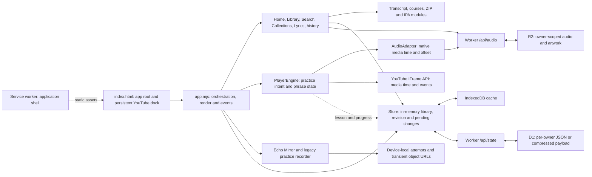
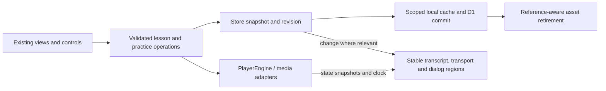

# Architecture assessment

Echo Studio has a useful runtime split for a personal application. The browser owns practice, editing and local persistence. A small Sites Worker owns authenticated storage and serving packaged assets. Browser media clocks drive timing. D1's revision check prevents blind overwrites of a newer snapshot for the same owner. The weaknesses surfaced where several callers can change the same domain state or where logic assumes that a successful operation in one store guarantees consistency in another.

The key flows are detailed in the [architect's module map](specialists/software-architect.md), [playback investigation](specialists/playback-engineer.md) and [data investigation](specialists/data-engineer.md). Representative ownership in the audited code:

| State or operation | Authority in current implementation | Failure boundary |
| --- | --- | --- |
| Actual playhead | Native audio or IFrame clock, decoded by adapter | UI and controller must distinguish requested time, acknowledged seek and sampled position. Mirror has a separate playback path. |
| Chosen phrase and practice intent | `PlayerEngine`, with UI rendering and option handlers | Mode, filter, next-action label and session accounting can diverge. |
| Lesson, progress and course relationships | The active engine holds a reference to a lesson in mutable `Store.data`. UI and library callers also mutate it. | Two deletion paths and replacement rules apply different invariants. Replacing the snapshot also replaces object identity. |
| Cross-device commit | D1 compare-and-swap by resolved owner and revision | Revision alone is not an account key. IDB cache, conflict choice and R2 cleanup need separate durability guarantees. |
| Media asset existence | R2 object for a Worker-owned URL | Upload and metadata commit have distinct lifetimes. A queued delete can outlive the decision that made it safe. |
| Retained focus/navigation state | `ScreenHistory`, per-view state and explicit capture/restore around full shell renders | Periodic saves can recreate interactive nodes and remove focus from a running practice session. |
| Deployment and offline startup | Worker build's embedded assets and fixed service-worker list | Successful build and online boot can coexist with a missing offline module. |

## Target boundaries, in order of need

Keep Sites, D1 snapshots, R2, vanilla modules and the persistent player host. Introduce domain operations only where the evidence shows competing paths. Use one lesson/course mutation path and one explicit rule for committing and retiring media references. Define practice state separate from media events and session history so transport decisions and labels use the same mode and queue. Move focus-critical regions toward stable DOM nodes as each area needs repair. Make the build's emitted assets the basis for offline verification.

This target does not require a framework migration, new backend or all-at-once `app.mjs` split. Evaluate boundaries by observed behavior: identical deletions through both entry points, no surviving references to retired assets, one source of truth for transport actions, no lost focus during progress saves, and an offline browser that boots cached metadata after a verified online visit. The [roadmap](roadmap.md) sequences these checks and the [findings register](findings.md) records the underlying evidence.
