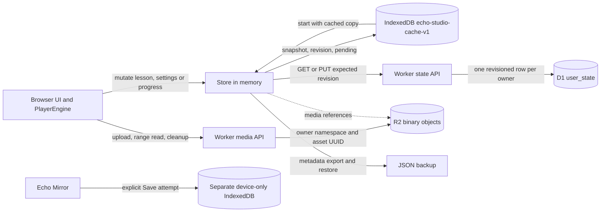
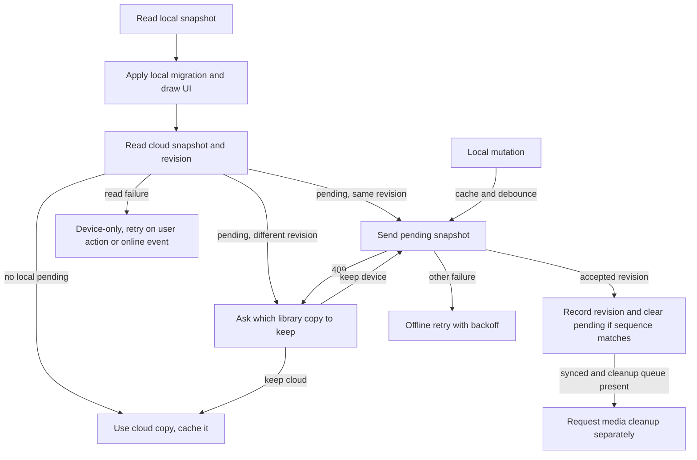

# Data and synchronisation assessment

ECHO-D1 · `/root/data_engineer` · Audit of `work` at `923d203f4d303b838cfec64ffc52686fe8f8c335`. The most immediate integrity problem is a saved media reference that can outlive the object it names. The versioned snapshot itself is a reasonable fit for the current library. Fix reference handling, recovery and progress preservation before considering finer-grained persistence.

## Ownership and lifecycle

| Entity | Identity and authority | Recovery and dependencies |
| --- | --- | --- |
| Account snapshot | Trusted Sites email normalised by the Worker. D1 row supplies the last accepted revision. An offline browser owns its pending copy until sync succeeds or an explicit conflict choice replaces it. | `src/store.mjs:14–48`, `server/worker.mjs:27–62`. Same-origin cache scope is covered by the security assessment. |
| Lesson and source | Internal UUID from `createLesson`; YouTube/video ID is an import matching key, not the internal lesson identity. Course membership is expressed both as `lesson.courseId` and `course.lessonIds`, while collections hold separate ID lists. | A ZIP repair can update captions without changing the media or course. Replace and reuse preserve the lesson ID. Movement should keep both membership links consistent. See ARC-01 for duplicate deletion paths. `src/store.mjs:50`, `src/courses.mjs:5–8`, `src/library-ui.mjs:74–96`. |
| Transcript and progress | Retained caption source, parsed segments and editable phrases are separate. Phrase IDs key Practised/Difficult statuses and pause overrides. Saved cursor includes media position and phrase ID, with coverage intervals and an independent session history. | Exact cue IDs can survive timing migration. When identity changes, remap conservatively by time/text, retain versions and avoid rewriting deliberate edits. Imported repairs and routine UI edits should preserve the latest cursor unless the user explicitly restarts. `src/playback-recovery.mjs:11–41`, `src/app.mjs:242–251,374–380`. |
| Recording/artwork | Generated server object UUID plus owner prefix. D1 stores a reference, and R2 stores the bytes. | Upload precedes metadata commit. An interrupted upload workflow can leave unused objects. Removal queues a candidate after the metadata save. JSON can restore reference fields but contains no audio or image bytes. `src/library-ui.mjs:67–92`, `src/app.mjs:256–287`, `server/audio.mjs:4–28`. |
| Echo Mirror | Saved attempts are local records keyed by attempt UUID with lesson/phrase/audio IDs, timing and offset. | A changed phrase or audio is labelled older/different. Saved recordings survive refresh in the same browser storage and are excluded from account sync and JSON backups. Clearing that storage removes them. `src/mirror.mjs:7–10,50–58`, `docs/ECHO_MIRROR.md:9–15`. |

## Sync and migration

The sequence test protects edits that happen while a PUT is in flight. D1 compare-and-set (CAS) prevents blind revision overwrite. The browser conflict flow intentionally asks the user to select an entire copy rather than merging records. A cloud conflict choice rebinds the active player to the new lesson object when its ID still exists (`src/app.mjs:297–304`). The IndexedDB transaction and D1 acknowledgement are separate. A cached pending value can still describe a write that reached D1 when its response was lost, so differing revisions do not by themselves establish divergent contents.

The original SQL migration creates a JSON-checked row with a per-owner key and revision. `drizzle/0001_snapshot_payload.sql:1` adds a nullable BLOB. The Worker reads `payload ?? data`, writes small snapshots as JSON, and uses a valid JSON marker plus a gzip payload with interning for repeated UUIDs above the encoding threshold (`server/worker.mjs:5–24,36–59`). `server/schema.sql` already includes the added column for fresh provisioning. `tests/snapshot-sqlite.test.mjs:5–6` covers legacy rows, compare-and-set, lossless compressed round trips, and owner separation with in-memory SQLite. It does not establish hosted D1 limits or migration status. Treat a pre-payload Worker rollback as incompatible with rows whose `data` column is only a marker, even though the SQL change is additive. Preserve a dual-format reader in rollback candidates and verify older and newer synthetic rows before rollout.

## Findings

### D1-01 · ZIP replacement deletes artwork still referenced by the lesson

- **Owner/domain:** Data Engineer, media lifecycle. **Severity:** Medium. **Confidence:** High. **Classification:** Confirmed defect. **Independent validation:** Pending.
- **Evidence and reproduction:** In Chromium 156 at 390 × 844 against a disposable preview, create a library with one lesson and uploaded artwork. Import a WAV/SRT ZIP for the same video ID without artwork and choose **Replace assets, preserve progress**. The saved lesson kept its existing ID and thumbnail URL. The thumbnail changed from HTTP 200 to 404. New audio returned 200. No page errors. `src/library-ui.mjs:84–89` queues existing audio, thumbnail and frame URLs, then `Object.assign(existing,lesson)` preserves omitted image fields. `src/app.mjs:283–287` and `server/audio.mjs:25–28` permit cleanup after sync without a reference check.
- **Root cause and impact:** The replacement updates fields and deletion candidates independently. A missing incoming image survives as a metadata field but is retired as a binary. Artwork becomes unavailable across reloads and devices until reuploaded or replaced. It affects intentional ZIP replacements with missing or failed artwork uploads. The directly observed loss was artwork. D1-02 describes a separate route to the same invariant failure for audio.
- **Fix and effort:** About 1–2 engineering days for the narrow replacement fix and tests. Define keep/replace/remove semantics for each asset field. Build retirement candidates from references actually removed. Guard all non-local retirement against still-referenced assets, with the stronger cross-revision policy in D1-02. Depends on a common media reference inventory across lesson audio, images and course covers. Moderate regression risk across replacement, failed optional uploads and retention.
- **Acceptance and regression:** Missing or failed artwork preserves the prior working reference. Successful replacement updates the reference before retiring the prior asset. Verify the two paths with ZIP, repeat after reload, and test a media ref shared by two lessons. Keep the existing progress and lesson ID assertions.

### D1-02 · Restoring metadata can carry a stale deletion intent

- **Owner/domain:** Data Engineer, backup and media integrity. **Severity:** High if the audio loss sequence is verified. **Confidence:** Medium. **Classification:** Suspected defect from source inspection. **Independent validation:** Pending.
- **Evidence and trigger:** `Store.restore()` assigns backup keys into the existing object (`src/store.mjs:47–48`). `initialData()` provides no default `pendingAudioDeletes` (line 5). If a user exports a library with uploaded audio before any pending deletion, changes/removes that source during a delayed cloud save and then restores the earlier export, the export can have no cleanup key. The old queue can therefore remain next to the restored live audio reference. `cleanupAudio()` consults mode, pending and URL syntax, with no reachability test (`src/app.mjs:273–287`). Static analysis predicts that a subsequent successful save can expose the still-referenced file to cleanup. Browser work on this route stopped at an obsolete player selector before removal or restore actions ran. No audio loss was observed.
- **Root cause and impact:** Restore behaves as an overlay despite its replace-library wording, and operational deletion intent is mixed into exported state. Since the JSON contains only media references, the previous recording may not be recoverable from that export after cleanup. Revisions order metadata changes, but do not make D1 and R2 one transaction. Already-issued cleanup and concurrent restores also need a policy.
- **Fix and effort:** About 2–4 days for replacement-state semantics, separation of portable metadata from operational intents, and safe handling of pending/legacy queues. Initially avoid physical deletion when reachability is uncertain. Longer-term choose a revision-aware cleanup policy with a grace window and verification against accepted references, or keep explicit confirmation for retention trade-offs. Preserve unknown portable extensions where supported, but default to not replaying stale deletion intents. Medium/high regression risk for recovery, media retention and existing exports; coordinate with Security and QA.
- **Acceptance and regression:** After a rejected/delayed save, restoring a backup with or without legacy queue fields preserves every currently referenced synthetic file. An intentionally removed file can be retired safely without invalidating another reference. Verify two browser contexts, supported older backup shape, explicit keep-cloud/keep-device choices, and delayed completion. UI distinguishes a metadata backup from a media archive.

### D1-03 · Undo seeks to the first cue and saves the resulting cursor

- **Owner/domain:** Data Engineer with Playback, persisted progress. **Severity:** Medium. **Confidence:** High in code path. **Classification:** Suspected defect, static reproduction conditions. **Independent validation:** Pending.
- **Evidence and trigger:** The current timing migration does not intend to overwrite the current position on Undo (`docs/PLAYBACK_SYNC.md:22`). The revision snapshot excludes its old progress from ordinary Undo (`src/playback-recovery.mjs:27–29`). But the UI restores the snapshot and seeks the first phrase (`src/app.mjs:380`). `PlayerEngine.seekPhrase()` sets `time` to the chosen phrase and calls `onSave` on a valid target (`src/player.mjs:174–179`), and `saveProgress()` writes that time and phrase ID (`src/app.mjs:242,304`). A user undoing a structural change while located later in a playable lesson can be returned to the beginning and persist the earlier resume position. Regroup also explicitly resets to the first phrase (`src/app.mjs:379`), which should receive a separate product decision. The Undo UI scenario was not reached in the probe. Existing migration tests verify saved progress before Undo.
- **Root cause and impact:** Revision payload correctly keeps transport progress independent, but the UI passes a restart instruction after changing phrase structure. Playback resume position is vulnerable; this evidence does not indicate loss of coverage or all practice markers.
- **Fix and effort:** About 1–2 days. Keep current recording time, map the active phrase using the restored timestamps, and retain paused/playing intent as agreed with Playback. Reuse source-clock alignment helpers for overlaps, gaps and offsets. Moderate risk to transport and edit behavior.
- **Acceptance and regression:** Undo with a valid cursor inside the second or later cue preserves the saved media position, coverage, and the restored phrase association after reload. Check gaps, overlapping cues, active/paused transport and native media offsets. Check intentional Restart still moves the cursor.

### D1-04 · An over-limit snapshot is treated as temporary connectivity loss

- **Owner/domain:** Data Engineer, reliability and recovery. **Severity:** Medium. **Confidence:** High from source. **Classification:** Design weakness. **Independent validation:** Pending.
- **Evidence and trigger:** Both raw and encoded storage ceilings return 413 with recovery guidance (`server/worker.mjs:5,41–49`). `Store.flush()` only distinguishes 409, OK and a generic throw; the catch sets `offline` and schedules exponential retries capped at 30 seconds (`src/store.mjs:31–42`). The visible notice says sync is unavailable and offers Retry, without the server guidance (`src/sync-notice.mjs:4–17`). If transcript-heavy edits produce an oversized snapshot while IDB still works, the pending copy remains local and repeatedly sends an unchanged request. This is distinct from ARC-02, which rejects otherwise acceptable ZIP imports before uploading or attempting the API.
- **Root cause and impact:** Service availability and corrective errors share one mode. The user lacks a clear signal that the library needs to be reduced or exported; resending consumes time and resources with no likely change in outcome. A lost response after a successful commit can also land in the 409 choice on retry even for the same uploaded content, but that separate case remains an untested follow-up.
- **Fix and effort:** About 1–2 days for a typed save outcome, bounded actionable user guidance, pending durability and retry only after an eligible change. Coordinate preflight limits and sync messaging with ARC-02 and UX. Moderate risk of accidentally disabling retries for temporary failures.
- **Acceptance and regression:** 413 keeps durable local changes and offers backup/recovery, with no repeated unchanged upload. A smaller edit can sync, and 503 or network loss still retries. 409 retains the distinct conflict decision. Bound requests under raw size and compressed storage cases independently.

### D1-05 · IndexedDB failure prevents otherwise available cloud saves

- **Owner/domain:** Data Engineer, local/remote failure isolation. **Severity:** Medium. **Confidence:** High in code path. **Classification:** Suspected defect, static. **Independent validation:** Pending.
- **Evidence and trigger:** `saveCache()` sets `mode='storage-error'` after any local write failure, `flush()` refuses to save in that mode and `retry()` only changes `offline` or reconnects from `local` (`src/store.mjs:14–16,26–42`). After initial GET to working cloud followed by an IDB failure (quota, browser storage restriction or interrupted transaction), normal edits stay pending with a storage warning and are no longer sent to a potentially healthy cloud. Browser storage failure was not injected in this audit.
- **Root cause and impact:** A single enum carries remote transport, conflict and local durability status. A local error blocks unrelated remote progress. The current warning correctly says the local copy may be unavailable, but pending practice is exposed to loss on reload even when D1 could accept the save.
- **Fix and effort:** About 1–2 days to model local cache durability and cloud save status separately, share outcome presentation with D1-04, and avoid treating the cloud as reachable when no signed-in revision has been read. Moderate risk around startup, CAS and offline recovery.
- **Acceptance and regression:** With valid cloud read and unavailable IDB, a successful PUT is acknowledged and survives reload from cloud. If both stores fail, warn that pending data is volatile and offer a backup. Cover IDB quota/recovery, a stale revision conflict, offline edits with a healthy cache, and denied cloud authentication.

## Verification and boundaries

| Check | Outcome |
| --- | --- |
| Lead baseline `npm test` on pristine archive | 170 passed, including SQLite legacy/additive migration and compressed round-trip checks. |
| `node --test tests/store-retry.test.mjs tests/sync-regression.test.mjs` | 13 passed, zero failures/skips. Network save tests use mocks and check transient retry and conflict blocking. |
| `python3 /tmp/echo-audit-d1-media.py` against `node scripts/dev.mjs --host 127.0.0.1 --port 4216` | ZIP artwork replacement scenario completed and demonstrated D1-01. The script as a whole exited 1 at `.mobile-more`, a historical selector absent on this revision. Restore and Undo scenarios were not completed. Application and server code were the pristine archive, assets and libraries synthetic, external browser requests blocked. |
| Production persistence and device-local recording | No production data was contacted. Hosted D1/R2, multi-device browser storage failures, physical devices and saved attempt binary recovery were not tested by this lane. |

Preserve compare-and-set, the pending IndexedDB copy where durable, ordinary Undo and exact-cue recovery safeguards, and the separate local recording store. Initial media lifecycle changes should protect referenced files and distinguish unsynchronised metadata from uploaded bytes. An orphan created by process loss between upload and metadata commit remains a documented operational limit (`docs/ZIP_IMPORT.md:32`). Keep orphan cleanup distinct from user-visible loss of referenced media, and design it to favour preserving still-usable files. Verify ARC-01 and the media lifecycle together before consolidating deletion paths.
