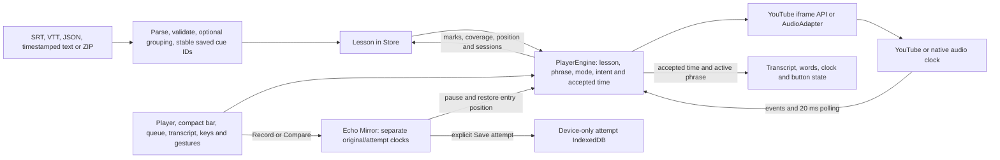
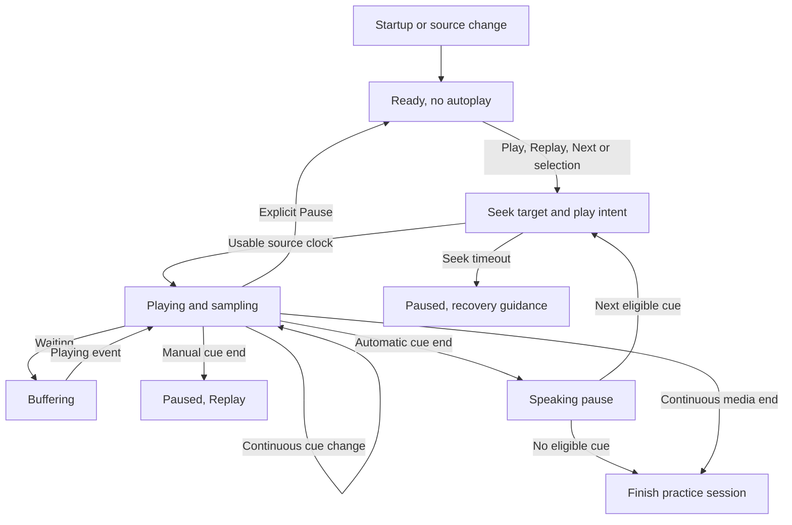

# Playback and transcript assessment

ECHO-P1. Playback Engineer, audit mode. Assessed `work` at `923d203f4d303b838cfec64ffc52686fe8f8c335`. The local browser used generated audio, a disposable server and synthetic lesson state. Findings describe this revision. Independent dispositions belong in the consolidated audit.

## Current contract and authority

The original deployed audio controller at `f69042d:src/components/Player.tsx:27` and `:49` resolves each native `timeupdate` against the first original cue covering the current clock. Current Continuous intentionally retains that overlap policy, keeps the previous phrase visible in gaps and keeps playing at cue boundaries. Manual and Automatic use the explicitly selected phrase, optional lead-in and the cue end, with Automatic pausing for speech before starting the next eligible phrase. Next marks the current phrase Practised. Passive listening, Replay, previous, Automatic advancement and direct transcript selection leave marks alone. The original proposal for unlimited looping and older control layouts have been superseded. [Current player decisions](../../../PLAYER_DECISIONS.md) · [Timing history and replay contract](../../../PLAYBACK_SYNC.md)



The source clock is authoritative after seek confirmation. `PlayerEngine` owns requested and observed state during buffering/seek, maps the recording clock to a cue, and records transition intent. `AudioAdapter` adds the signed offset when seeking and subtracts it on clock readback. The YouTube adapter exposes the iframe's own clock and state events. `generation` gates callbacks from replaced sources, while `pendingSeek` prevents a stale clock or ENDED event concluding a newly requested phrase. `token` invalidates Automatic pause timers as new actions arrive. Browser timing still depends on when native events or polling can run. Views use the engine's observed state. Mirror keeps its own media and cancellation tokens for explicit capture and comparisons. [Transport controller](../../../../src/player.mjs#L25) · [Offset and native events](../../../../src/audio.mjs#L11) · [View wiring](../../../../src/app.mjs#L227) · [Mirror source clock and capture](../../../../src/mirror.mjs#L36)



`7c0c4ee` added seek alignment and `d923157` protected the requested phrase during native lead-in. `03f8eaf` carried forward the original cue policy. `9e3080b` added rolling-caption detection and repair for eligible saved lessons. Current parsing retains SRT and VTT ends, only estimates ends for start-only text, and discards invalid supplied word timings. Recovery backs up changed unedited lessons, protects deliberate revisions and preserves global mode and lead-in. A tagged exact cue is retained through direct comparisons where possible. See the Data Engineer assessment for persistence and migration risks. [Parser and validation](../../../../src/transcript.mjs#L19) · [Recovery](../../../../src/playback-recovery.mjs#L4) · [Original clock test](../../../../tests/original-playback.test.mjs#L8) · [Seek regressions](../../../../tests/seek-alignment.test.mjs#L11)

## Evidence from this run

| Check | Observed result | Scope |
| --- | --- | --- |
| `node --test tests/player.test.mjs tests/audio.test.mjs tests/audio-player.test.mjs tests/seek-alignment.test.mjs tests/original-playback.test.mjs tests/rolling-captions.test.mjs tests/timestamped-text.test.mjs tests/domain.test.mjs tests/mirror.test.mjs tests/microphone.test.mjs` | 71 passed, 0 failed, 0 skipped | Targeted subset of the baseline suite. Media states, timeout/error, offset, permission and several navigation conditions use doubles. |
| Player via `node scripts/dev.mjs --host 127.0.0.1 --port 4215`; `python3 /tmp/echo-audit-p1-browser.py` | At 390 × 844 simulated mobile Chromium 156, two Manual Reset runs stopped at 2.253 and 2.261 s for a 2.250 s cue end. A run changing speed while active to 1.5× stopped at 2.272 s. Each repeated reset returned to the requested 1.0 s cue, within the 0.35 s observation window. | Native Chromium audio was real uncompressed 16 kHz generated WAV. These three sampled values include observation timing and make no claim about physical speech alignment, statistical bounds or another device. |
| Same browser run, transport and navigation | Rapid Next, Next, Previous chose the requested cues. Compact and expand preserved one native audio instance and the active cue. Reload restored the second cue paused. Automatic stopped at the first cue end, then advanced and played the second after its configured speaking pause. No page errors observed. | Real local browsing and media. Browser context had external requests blocked and service workers disabled. |
| Same browser run, synthetic regression probes | Reproduced PB-01 and PB-02 through normal controls. Reproduced PB-03 with Chromium's fake microphone and a real native media EOF. | A simulated microphone source, not a physical mic or iOS recorder. |
| `python3 /tmp/echo-audit-p1-vtt.py` | Reproduced PB-04 in the import preview. Removing only the STYLE block made the same cue previewable. | No external media, no saved lesson change. |

Browser scripts and logs are temporary run artifacts. The conditions below allow repeat verification without them. Live YouTube, restricted or unavailable real videos, physical microphones, preserved offline PWA assets and foreground/background transitions on a physical mobile browser were unrun. YouTube unavailable, delayed seek, autoplay and rate paths are covered by the indicated adapter tests. The app does not explicitly pause ordinary playback at page hide, and releases Mirror/recorder and wake lock while saving progress. The 20 ms boundary check is a pacing mechanism, with no guaranteed stop precision when script execution is suspended. [Visibility handler](../../../../src/app.mjs#L431) · [Adapter tests](../../../../tests/player.test.mjs#L19)

## Findings

### PB-01 — A practice filter changes Continuous transport

**Owner and domain:** Playback Engineer, playback and navigation. **Severity:** Medium. **Confidence:** High. **Class:** Confirmed defect. **Independent validation:** Pending at specialist handoff.

**Reproduction and evidence:** Load three cues in a normal native audio lesson and mark only the first Difficult. From Manual, choose Options → Practice → Difficult only → Apply selection. Change Options → Playback → Continuous. On cue one, the button already says **Finish practice**. Clicking it opens **Session complete** with cues two and three still available. The controller-only probe independently returned `mode=continuous`, `selection=difficult`, current cue `a`, state `ended`. Continuous media clock progression itself was unaffected. [Mode, selection and navigation](../../../../src/player.mjs#L166) · [Next and Previous](../../../../src/player.mjs#L202) · [Transport label](../../../../src/app.mjs#L94) · [Practice restriction copy](../../../../src/app.mjs#L120)

**Root cause and impact:** `setMode()` updates `mode` without neutralising the selected scope. Ticks in Continuous resolve all source cues, while `eligible()` remains filtered for queue, navigation and last-cue detection. This creates two definitions of the active sequence. A user who leaves focused practice can skip normal cues or accidentally end a session. Settings reset or leaving the lesson can recover it.

**Remediation, effort and risk:** Establish one effective sequence for each mode and use it for transport, queue and the completion label. Keep the preferred focused selection separately if the product chooses to restore it when returning to shadowing. About half a day including QA, with medium regression risk for navigation and marking. Depends on agreeing whether switching back restores the filter. No migration needed.

**Acceptance and regression:** With three cues of which only one is Difficult, switch between all modes in paused and playing states. Next in Continuous selects the ordinary adjacent cue, updates once and marks only the departing cue. Previous, swipe, eligible queue and finish label agree. Automatic still honours the selected subset and passive advancement never marks. Add an engine transition test and a browser journey using normal controls.

### PB-02 — Session reports include earlier practice

**Owner and domain:** Playback Engineer, practice progress and session data. **Severity:** Medium. **Confidence:** High. **Class:** Confirmed defect. **Independent validation:** Pending at specialist handoff.

**Reproduction and evidence:** Seed a lesson with older partial coverage of cue `c`, `c` already Practised and cue `a` Difficult. Complete a new session through the button in PB-01 before starting audio. The visible summary reported `1 Phrases heard`, `0m Active listening`, `2 Practised`, `1 Difficult`. Stored session record has `activeSeconds: 0`, `coveredIds: ['c']`, `practised: 2` and `difficult: 1`. Next legitimately marked cue `a`; the earlier mark on `c` and its historical coverage carried into the new session. The standalone controller probe reproduced the earlier-only cue count without depending on rendered labels. [Session clock accumulation and finalisation](../../../../src/player.mjs#L234) · [Summary and history](../../../../src/app.mjs#L163) · [Session completion contract](../../../../spec.md#L1136)

**Root cause and impact:** `startSession()` creates session fields, but `tick()` adds coverage to lesson progress only. `finishSession()` reads cumulative lesson coverage and current lifetime statuses. The app mixes an actual session duration with lesson totals under a session heading, so repeat practice reports inaccurate progress and old records cannot be corrected from the available data.

**Remediation, effort and risk:** Track session-local cue coverage and mark changes per session while retaining lesson-level coverage. Show lifetime context separately if useful. Preserve and label historical entries whose original measurement is unknowable. Around one to two days including QA, with medium risk for history and stats compatibility. Coordinate the session and snapshot shape with the Data Engineer. PB-01 improves the trigger but does not repair cumulative accounting.

**Acceptance and regression:** A second session with no accepted movement reports zero newly heard cues. Hearing the same cue in a later session counts for both sessions even when lifetime coverage is already complete. Seeks, retries, paused intervals, clipped/unavailable media and speaking pauses add no listening. Explicit status changes are handled consistently and earlier marks remain at lesson level. Test consecutive sessions, lossless legacy reads and the real summary/history interaction.

### PB-03 — Mirror starts capture after a truncated original

**Owner and domain:** Playback Engineer, Echo Mirror and trimmed audio. **Severity:** Medium. **Confidence:** High. **Class:** Confirmed defect. **Independent validation:** Pending at specialist handoff.

**Reproduction and evidence:** On a 2.0 s uploaded-audio fixture, select a cue with source bounds 1.6–2.8 s. Press **Listen then record** with a permitted fake Chromium microphone. The original ends at 2.0 s and the UI enters **Stop recording**. Observed second native audio instance `currentTime: 2, duration: 2, ended: true`, while the main transport under the same cue subsequently showed **Playback unavailable**. An offset or a differently trimmed file can cause this mismatch in practice. [Mirror source bounds and EOF](../../../../src/mirror.mjs#L36) · [Start capture condition](../../../../src/mirror.mjs#L26) · [Main player bounds](../../../../src/player.mjs#L158)

**Root cause and impact:** Mirror accepts an end beyond the source duration and treats any native EOF as successful completion of the original. The main player checks both ends of the source range. A learner can record after hearing only part of the target and later compare it against a misleading original boundary. Capture follows a deliberate Record action and browser permission. No background or upload disclosure is claimed.

**Remediation, effort and risk:** Reuse source-time conversion and phrase availability as a shared pure check, while preserving separate capture and comparison control. Treat premature EOF as failure, release the microphone and show specific matching/offset guidance. About half to one day, with medium regression risk to codec metadata and offset handling. Confirm tolerance with Playback Engineer and QA before reuse.

**Acceptance and regression:** An unavailable start or end never enters capture. A fully playable phrase ending near source EOF succeeds within documented metadata tolerance. Mid-phrase media failure releases tracks, preserves attempts and provides a retry path. Test trimmed start/end, positive and negative offsets, cancellation during metadata wait, and valid EOF with generated audio and simulated microphone.

### PB-04 — Valid WebVTT style blocks prevent manual import

**Owner and domain:** Playback Engineer, transcript parsing and import. **Severity:** Medium. **Confidence:** High for manual preview with a STYLE block. **Class:** Confirmed defect. **Independent validation:** Pending at specialist handoff.

**Reproduction and evidence:** In Add lessons → YouTube lesson, supply a syntactically valid video URL and paste the following transcript before choosing **Preview**. The app reports **A caption block has no timestamp.** and disables Save. Deleting the STYLE block alone enables preview and Save for the same cue. This does not start YouTube playback. [WebVTT parser](../../../../src/transcript.mjs#L53) · [Leading block detection inherited from SRT](../../../../src/transcript.mjs#L19) · [Manual preview and save](../../../../src/app.mjs#L246)

```vtt
WEBVTT

STYLE
::cue { color: lime; }

cue-one
00:00:00.000 --> 00:00:01.000
Hello world.
```

**Root cause and impact:** `parseVTT()` strips the header and NOTE blocks, then hands the remainder directly to the SRT parser. The latter treats leading undecorated text as a missing timestamp. A supported WebVTT export can therefore be blocked even when cue times and text are valid. ZIP has a separate wrapper that can report parser problems as notes and continue with valid segments. The observed fatal behavior is scoped to manual preview. [ZIP transcript wrapper](../../../../src/import-transcript.mjs#L5)

**Remediation, effort and risk:** Recognise WebVTT metadata, valid blocks before cues and cue identifiers before applying existing timed cue validation. Ignore style and region styling in practice without treating them as spoken content. Around half to one day, with low to medium risk of SRT or rolling-caption regressions. Check both import surfaces and recovery wrappers. No schema change.

**Acceptance and regression:** A conforming STYLE/REGION/NOTE fixture yields only intended cue text and exact intervals. Bad cue times still return actionable errors. SRT without blank separators, ordinary repeated speech, YouTube rolling transitions and existing saved-caption repair continue to pass. Add parser fixtures and a normal manual Preview check.

## Priorities and review requests

Start with PB-01 because it interrupts the normal practice path after switching modes. Track PB-02 with the same regression journey and a separate session-local accounting change. Fix PB-03 without coupling microphone capture to the main transport. Keep PB-04 within the existing transcript normalisation boundary. Preserve clock authority, pending seek checks, native offset convention, passive listening semantics and deliberate repair backups. Ask the Independent Reviewer to check the Continuous mode contract, the distinction between lifetime and session stats, Mirror's premature EOF, and the exact WebVTT reproduction. A future release exercise should verify supported live YouTube behavior and physical mobile boundaries separately.

## Cross-domain review

- **Mirror source availability and recording lifetime.** PB-03 belongs to the original-audio → capture transition in Mirror. Reuse a pure media-time conversion/bounds check with the main transport. SEC-03 belongs to the separate Options recorder and the lifetime of an outstanding permission request. The wrappers already call `stop()` on exit, but only Mirror's token invalidates a pending grant. Fix cancellation and track ownership first as a privacy control. Reuse the token and late-grant release pattern, or a narrow shared capture lifecycle only if it reduces code. Keep ordinary untimed recording, Mirror's explicit listen-then-record sequence and the main player independent. These are separate acceptance conditions and do not require combining controllers. This cross-check was source-only and did not run new microphone tests. [Security assessment](security-engineer.md#sec-03--legacy-recorder-can-begin-capture-after-options-close) · [Legacy recorder](../../../../src/recorder.mjs#L2) · [Options dismissal](../../../../src/app.mjs#L306) · [Mirror cancellation](../../../../src/mirror.mjs#L17)
- **Undo and the saved recording cursor.** D1-03 correctly separates the structural snapshot from transport. Capture the current usable recording time before Undo, then resolve the active cue against the restored array, by a still-valid compatible ID or the mode's time lookup. Reuse the `seekRecording`/`beginSeek` path with an explicit current-time policy for in-flight seeks, native bounds and no autoplay. A direct substitution needs care. In Continuous gaps `seekRecording` can retain a phrase object removed by Undo, and bounds are currently clamped after mapping. Choose a valid restored fallback when a timed match is absent and preserve first-match overlap semantics. Existing original-playback recovery tests assert that migration preserves position, and existing seek tests cover clock alignment. The missing regression is a real Undo interaction while on a later cue, verifying no rewind, preserved coverage and the restored cue ID after reload. `browser_extended.py` only checks the resulting row count and is a legacy fixture. Add a test through the current player and a focused seek regression for a gap or changed cue IDs. No Undo UI test ran in this lane. [Data assessment](data-engineer.md#d1-03--undo-seeks-to-the-first-cue-and-saves-the-resulting-cursor) · [Undo and save](../../../../src/app.mjs#L380) · [Recording seek](../../../../src/player.mjs#L181) · [Legacy Undo assertion](../../../../tests/browser_extended.py#L33)
