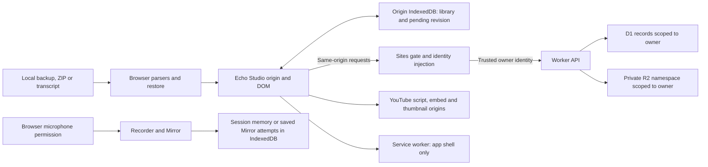

# Application security and privacy

**ECHO-S1.** Native specialist task `/root/security_engineer`, audit mode, `work` at `923d203f4d303b838cfec64ffc52686fe8f8c335`. Static source and packaged-Worker review, existing synthetic tests, and public npm advisory metadata. Effective Sites access controls and browser/physical microphone behavior remain unverified. No account, production library, real recording or credential was used.

## Trust model

Assets include library and transcript metadata, practice history, private uploaded audio and artwork, and recordings. Trust boundaries include a user-selected file becoming browser data, rendering imported or synced data in the app origin, sharing an origin across browser sessions, injecting the Sites identity at the hosting boundary, and handing control to third-party playback code. The local preview has its own boundary and synthetic identity. The application and automation need no client-side secret for the documented local workflow.

| Control area | Evidence and limits |
| --- | --- |
| Auth and owner isolation | The Worker rejects missing/malformed trusted identity and derives ownership from the hosting header, not request JSON. Parameter-bound D1 queries all use that owner, writes use compare-and-swap revisions, and R2 keys derive a hash prefix from the owner plus a validated object ID. Audio GET/HEAD use `private, no-store`; state uses `no-store`. These controls depend on Sites overwriting external identity input, authenticating the route and keeping the bucket private. The checkout declares bindings, not the effective access policy. ([Worker](../../../../server/worker.mjs#L26-L59), [audio handler](../../../../server/audio.mjs#L4-L40), [hosting metadata](../../../../.openai/hosting.json)) |
| Injection and URL handling | Parameterized SQL and escaped phrase/title text are present. The typed YouTube URL path converts allowlisted hostnames into a constrained video ID, and the adapter validates that ID again and passes the page origin to the player. Native lesson audio checks for a same-origin object path. Restored fields and some DOM attributes do not share a validation boundary. Image templates escape HTML but still accept stored URL destinations. ([transcript parser](../../../../src/transcript.mjs#L227-L236), [player](../../../../src/player.mjs#L11-L16), [player embed](../../../../src/player.mjs#L37-L57), [SEC-01](#sec-01--restored-snapshot-fields-cross-into-html)) |
| ZIP and uploads | ZIP checks traversal, unsupported/link/encrypted entries, declared file/aggregate/entry/decompression ratios and measured decompression size, and checks CRC. Metadata and captions have their own 2 MiB bounds. Media API restricts allowed MIME types, validates actual byte length and limits range reads. The browser ZIP import also checks recognizable audio signatures and decodes duration. No cumulative media quota was evident in the application handler. The compressed snapshot row cap complements the decoded request size cap. ([ZIP reader](../../../../src/zip-import.mjs#L4-L35), [metadata and captions](../../../../src/zip-import.mjs#L36-L57), [audio handler](../../../../server/audio.mjs#L10-L35), [SEC-05](#sec-05--request-bounds-apply-after-some-full-buffer-reads)) |
| Browser isolation and caching | Packaged document has `nosniff` and `strict-origin-when-cross-origin`. The packaged check found no CORS grants, CSP or Permissions-Policy on the sampled shell/API routes. Sites/edge policy may add controls. The service worker restricts caching to its allowlisted same-origin shell assets and bypasses `/api/`. Keep only needed script/frame/image origins when making CSP or permissions changes. Verify the approved host embed, YouTube, native media and microphone through normal controls. ([release wrapper](../../../../scripts/build.mjs#L11-L19), [service worker](../../../../sw.js#L1-L4)) |
| Voice retention and privacy | Mirror consent is explicit and its token rejects late permission after interruption. Saved attempts go to a separate device-local IndexedDB and do not enter the state payload/export; temporary attempts use in-memory blobs and object URLs. The separate recorder retains its session blob without upload. Ownership and cancellation issues are scoped in SEC-02 and SEC-03. ([Mirror](../../../../src/mirror.mjs#L8-L33), [save/delete](../../../../src/mirror.mjs#L45-L58), [retention contract](../../../../docs/ECHO_MIRROR.md#retention-and-privacy)) |
| Third-party processing | Echo loads the official YouTube IFrame API as first-party-page script and gives the iframe an origin and restricted referrer mode. It also prewarms the API at startup when there is no prepared lesson and startup is enabled. Trusted third-party JavaScript runs within the page, so keep that surface documented, consider deferring until needed, and verify the actual request destinations before adding a restrictive policy. The code provides no evidence of sending raw transcripts or voice blobs to YouTube. ([bootstrap](../../../../src/app.mjs#L433), [player](../../../../src/player.mjs#L5-L15), [artwork](../../../../src/ambient.mjs#L23-L31)) |
| Supply chain | `colorthief` is the only locked dependency, pinned at 3.5.0 with npm integrity and MIT notice. The vendored browser bundle and licence byte-match installed `dist/index.browser.js` and `LICENSE`. Public npm audit returned zero advisories for one dependency at audit time. Runtime/browser components and the externally loaded YouTube script fall outside that check. Keep vendor provenance in release verification. ([lockfile](../../../../package-lock.json), [vendor use](../../../../src/ambient.mjs#L1), [MIT notice](../../../../assets/colorthief-LICENSE.txt)) |

**Release check requiring authorised hosted verification.** From an isolated Sites environment with synthetic owners, verify that signed-out requests cannot read or mutate library/media, that the platform supplies the authenticated identity and strips conflicting user-supplied identity inputs, that a second authorised test owner is isolated even with known identifiers, that cookie/origin controls cover state-changing calls, and that there is no public object route. Review effective document headers and the reason for packaging the two diagnostic pages. Static absence of a live setting in this repository cannot establish exposure or an effective defence. Keep the managed host and the server-side ownership design.

## Findings

### SEC-01 · Restored snapshot fields cross into HTML

**Security Engineer · Untrusted imports / browser integrity · High proposed, high confidence in code path, runtime exploitability untested · Design weakness.** Settings offers a confirmed library replacement ([restore UI](../../../../src/app.mjs#L87), [file handling](../../../../src/app.mjs#L404)). [Store.restore](../../../../src/store.mjs#L48) and [Worker PUT](../../../../server/worker.mjs#L40-L48) check top-level shape and counts without restricting nested identifiers or URL fields. [Migration](../../../../src/courses.mjs#L4) adds defaults, leaving IDs intact. In the normal rendered library, [LibraryUI.row](../../../../src/library-ui.mjs#L23) places `item.id` and the derived key directly inside quoted attributes. Player and lesson markup also interpolate stored attributes such as `ambientPalette.source` ([player](../../../../src/app.mjs#L96), [lesson options](../../../../src/app.mjs#L119)). These strings reach [root.innerHTML](../../../../src/app.mjs#L190).

**Conditions, cause and impact.** A user restores a backup they did not generate or loads a snapshot containing unsafe nested values, then visits an affected view. The renderer implicitly trusts data that passed only container validation. This allows imported values to influence DOM markup in the same origin that can access lesson sync and device-local recording storage. The severity reflects that consequence if a hostile source can convince the owner to import it. The ordinary transcript text path and random IDs generated by ZIP import differ. No hostile file, script execution, account compromise or production reproduction was attempted.

**Remediation and tests.** Validate and normalise snapshots at restore, load and API boundaries, with explicit legacy ID compatibility. Keep text and identifiers in DOM text/value/attribute APIs or context-appropriate escaping at every remaining template. Enforce safe URL policy for media and artwork and layer a tested CSP as defence in depth. Reject unsafe shapes before replacing or persisting the old library. QA should use benign quotes, angle brackets and unusual legacy identifiers to assert literal rendering, expected DOM structure, rejection without state changes, and a valid old backup round-trip. Verify named media dependencies and stable lesson/phrase identities before rollout. **Effort:** 2–4 days. **Change risk:** medium/high, compatibility with large and legacy snapshots. **Depends on:** Data Engineer's entity/schema policy and hosting header capabilities. **Independent validation:** pending lead assignment.

### SEC-02 · Browser library cache is unscoped across account changes

**Security Engineer with Data Engineer · Confidentiality / sync identity · Medium, high confidence in code and conditional impact · Design weakness.** [Store.init and connect](../../../../src/store.mjs#L7-L29) load a shared origin-wide `state` key, make it available to rendering before the first account response, and compare numeric revisions without an owner key. [Worker GET](../../../../server/worker.mjs#L30-L38) returns revision and data for the current injected owner, with no browser-safe owner binding. Mirror storage is origin-wide as well, with saved attempts queried by lesson ID ([Mirror](../../../../src/mirror.mjs#L8-L10)).

**Conditions, cause and impact.** If another allowed account signs in within the same browser profile and origin, the previous library can be visible while checking or when cloud fails. With pending changes and the same revision for both accounts, the branch at Store.connect line 25 can flush the previous owner's library into the newly authenticated owner's snapshot. Where revisions differ, the conflict path can still offer the previous local copy. Mirror visibility through normal UI additionally requires a matching lesson ID, and recordings stay on the device. This is separate from server-side owner isolation. Severity may be higher in a deployment that allows multiple accounts on one profile. The audit did not exercise live account switching or establish that this deployment admits a second account.

**Remediation and tests.** Use a stable opaque owner binding supplied by Sites/authenticated API for browser cache, pending sync and Mirror ownership. Define offline access and explicit recovery for old unowned caches; preserve data without automatically assigning it to whoever signs in next. QA should seed two synthetic identities in one origin and cover successful switch, unsigned response, disconnected reload, equal/different revisions with pending edits, and existing Mirror attempts. Acceptance: no cross-account render or write, intentional same-owner offline/reconnect still works, legacy cache recovery is explicit. **Effort:** 3–5 days. **Change risk:** high, if offline and migration behavior are broken. **Depends on:** verified identity support and recovery policy. **Independent validation:** pending lead assignment.

### SEC-03 · Legacy recorder can begin capture after options close

**Security Engineer with Playback/UX · Microphone privacy · High proposed, high confidence in missing guard, browser prompt sequencing unverified · Defect established by source trace.** Active Options renders **Record yourself** and triggers [`PracticeRecorder.start`](../../../../src/app.mjs#L134) through [the action handler](../../../../src/app.mjs#L353). Closing options, navigating and hiding the page call `recorder.stop()` ([dismissal](../../../../src/app.mjs#L306), [navigation](../../../../src/app.mjs#L317), [visibility](../../../../src/app.mjs#L431)). [Recorder.start and stop](../../../../src/recorder.mjs#L2-L5) show that `stop()` acts only on an already-recording instance. The late-grant check reads `disposed`, which is initialised false and never changed by those exits. Echo Mirror already guards the equivalent race with a request token and immediate track release ([Mirror](../../../../src/mirror.mjs#L17-L30)).

**Conditions, cause and impact.** If the view closes or becomes hidden during a pending permission request and a grant resolves later, the old promise can start MediaRecorder after its controls are gone. Capture was initially user-requested and granted by the browser, but the pending request outlives its visible consent context. Capture remains device-local. Consequences include unexpected recording and retention in session memory until a later stop or tab close, plus memory use. No physical or simulated attempt targeting this legacy path ran during the audit.

**Remediation and tests.** Reuse the cancellation pattern or a deliberately small shared capture lifecycle. Invalidate outstanding requests on dismissal, route and visibility changes; stop a late-granted track before constructing any recorder. Bound capture and release tracks and temporary URLs reliably. Keep any consolidation decision separate from removing useful untimed recording. QA should first stub delay and exercise cancellation, only using simulated audio, then check start/stop/reopen and navigation during active capture in a supported browser. Acceptance: cancel/close/hidden leaves no active track or displaced result, and normal capture stays local and downloadable. **Effort:** 0.5–2 days. **Change risk:** medium, concurrent Mirror and legacy flows. **Depends on:** explicit legacy recording lifecycle and UX recovery. **Independent validation:** pending lead assignment.

### SEC-04 · Preview serves the checkout with one synthetic owner

**Security Engineer · Development isolation · Medium if a port is made reachable outside the development trust boundary, high confidence in source · Design weakness.** The local server defaults to loopback, accepts alternate bind addresses, injects the same synthetic owner into every API request and reads static files under its whole CWD. The production build uses a specific file list instead. ([Preview](../../../../scripts/dev.mjs#L7-L16), [build inputs](../../../../scripts/build.mjs#L4-L7))

**Conditions, cause and impact.** A preview is bound to a reachable interface, untrusted clients can reach the port, and the working directory contains inputs or state outside the intended app assets. Such a client would share fixture state and could read files the preview never meant to serve. The audit uses synthetic isolated fixtures; it did not assume a reachable portal or check unrelated file contents. **Remediation and tests.** Default to loopback for local tests. For any approved shared preview serve only runtime assets and require access control. Verify shell, modules and fixture APIs remain usable, and that a benign non-asset marker is excluded. **Effort:** 0.5–1 day. **Change risk:** low/medium for existing QA fixture routes. **Depends on:** developer preview needs and host routing. **Independent validation:** pending lead assignment.

### SEC-05 · Request bounds apply after some full-buffer reads

**Security Engineer with Performance · Resource limits · Medium, high confidence in code and unmeasured runtime impact · Design weakness.** [Worker PUT](../../../../server/worker.mjs#L40-L48) checks a declared length, then materialises the full `Request.text()` before measuring actual bytes if length is absent or insufficient. Compression adds more working memory while the request is live. A valid media body is bounded while streaming to one capped allocation, but the local preview first buffers the entire request before the Worker sees it ([audio handler](../../../../server/audio.mjs#L13-L17), [preview](../../../../scripts/dev.mjs#L11-L14)). Restore similarly reads the full backup before its shape/count checks ([restore handler](../../../../src/app.mjs#L404)).

**Conditions, cause and impact.** Large import or state operations, particularly on constrained devices or with retries, can allocate more than the intended input budget before application-level rejection. Actual Sites ingress limits and worker memory headroom remain unverified. ZIP already bounds real decompression and is a useful pattern. **Remediation and tests.** Precheck selected backup file size, read state bodies incrementally under the byte limit, and surface explicit permanent size errors separately from retryable transport errors. Size policies must accept valid legacy exports and compressed large libraries rather than reintroducing the obsolete 3 MB gate. Use reduced test limits, ordinary synthetic fixtures and scheduler assertions to verify early rejection without durable writes, accepted near-limit writes, and actionable recovery. **Effort:** 1–2 days. **Change risk:** medium, backup and retry compatibility. **Depends on:** current body/row budgets and release ingress limits. **Independent validation:** pending lead assignment.

## Verification log and recommendation

| Check | Result |
| --- | --- |
| Targeted `node --test` in pristine archive for `worker`, `audio-server`, `snapshot-sqlite`, `microphone`, `mirror`, `zip-courses` | 39 passed, zero failed/skipped. Covers missing owner, fake D1/R2 and SQLite owner scoping, version conflicts, private audio Range, input controls, ZIP integrity, and simulated Mirror permission outcomes. This is a subset of the lead's baseline suite. |
| Built Worker `fetch` with synthetic `GET /`, `/api/state`, `/api/audio`, `/tests/viewport.html`, `/tests/notices.html` | Shell and fixtures 200 with `nosniff`, `no-cache` and strict origin referrer behavior. Both API requests with no identity 401 with `no-store` and `nosniff`. CSP, Permissions-Policy and CORS grants absent on these packaged responses. No binding used. |
| `npm audit --omit=dev --json --cache /tmp/echo-audit-s1-npm-cache --fetch-retries=0` | Exit 0; zero advisories in one locked dependency. Registry advisory metadata only, no dependencies installed. |
| SHA-256 and `cmp` against the installed package | Browser bundle and MIT licence match Color Thief 3.5.0 byte-for-byte. |

Minimum next work is fixing pending microphone cancellation and building a durable snapshot trust boundary, while confirming Sites identity and access requirements. Score suggestion for app-level security is **5/10, medium confidence**, based on sound server scoping and deliberate private recording design, offset by unvalidated render data, uncancelled permission and cache identity gaps. Overall production security remains **unassessed**. Hosted verification and any changes require separate scope; the audit introduced no product changes.
