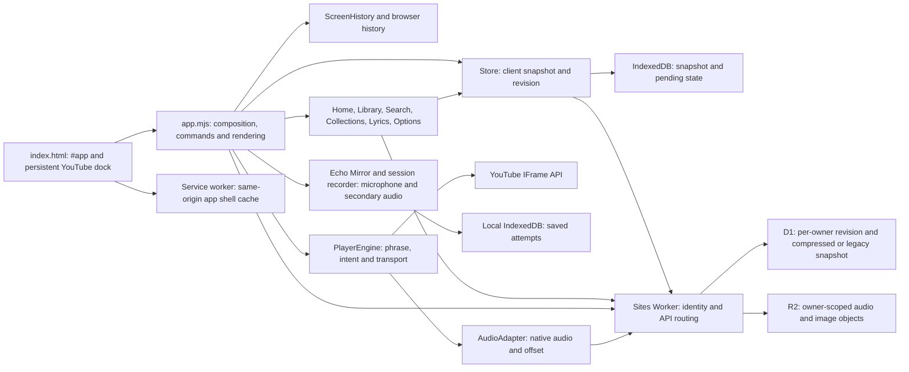
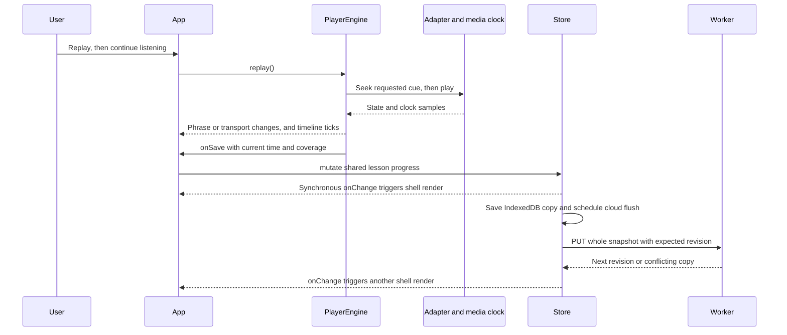
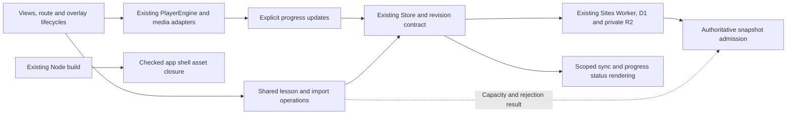

# Software architecture assessment

**Assignment** ECHO-A1 · **Native agent** `/root/software_architect` · **Mode** audit · **Status** complete

**Baseline** `work` at `923d203f4d303b838cfec64ffc52686fe8f8c335`. Audited app files match the revision. Build and browser checks used the lead's clean archive or a disposable in-memory development service.

Echo Studio's plain ESM frontend, small Worker, and adapter-based player remain a good fit. The important architectural weakness is that several workflows represent the same decision in multiple places. Four verified examples affect course continuation, ZIP import, offline startup and keyboard use. None requires a framework migration or a database redesign.

## Current architecture

| Concern | Authority and limits |
| --- | --- |
| Route and view | `src/app.mjs:21–40` owns `ui` and composes three feature controllers with their own state. `ScreenHistory` (`src/navigation.mjs:7–18`) stores the route projection, with history restoration writing controller fields. The playback clock stays outside route history. |
| Playback | `PlayerEngine` owns requested state and phrase intent (`src/player.mjs:107–154,174–202`). `AudioAdapter` maps native timestamps to the lesson clock (`src/audio.mjs:16–23`). YouTube and native events share the controller's callback contract. `#youtube-dock` is outside `#app` (`index.html:8–11`) so normal navigation preserves the iframe. Mirror temporarily uses separate audio for its exercise and restores the engine (`src/app.mjs:28,227–239`, `src/mirror.mjs:33–45`). |
| Lesson and progress | `Store.data` is the client library authority (`src/store.mjs:11–30`). `PlayerEngine.load` retains the lesson object by reference (`src/player.mjs:107–119`) and writes coverage in `tick` (`234–237`), while `saveProgress` updates resume position and signals Store (`src/app.mjs:241–243`). Cloud replacement reloads a different object for the same active lesson (`app.mjs:297–303`). Course membership is encoded as `lesson.courseId` and ordered `course.lessonIds` (`src/courses.mjs:5–14`). |
| Transcript | `transcript.mjs` supplies timed cue parsing, grouping, edits and matching. Manual import and ZIP share these primitives, but apply separate orchestration and persistence rules (`src/app.mjs:245–251`, `src/library-ui.mjs:67–92`, `src/import-transcript.mjs:4–12`). Applying intentional edits and backward-compatible migrations are separate responsibilities. |
| Durability | `Store` caches client state and handles optimistic cloud revisions and conflict choices (`src/store.mjs:14–45`). Worker uses identity-header checks and revision compare-and-set (`server/worker.mjs:26–59`) with a separate binary store for media (`server/audio.mjs`). A clean client save and R2 deletion are separate operations (`src/app.mjs:283–287`). This order has value; the data lane owns in-flight cleanup and recovery details. |
| Distribution | `scripts/build.mjs:3–24` embeds static assets and wraps the Worker, including a text transformation of two modules. `scripts/dev.mjs:1–16` uses the same source Worker with in-memory `DevDB` and `DevBucket`. App bootstrap registers the static-list service worker (`src/app.mjs:431–433`, `sw.js:1–4`). Dev behavior and generated Worker output provide different evidence from hosted Sites. |

No direct ESM cycles appeared in the 28-module entry dependency walk. The feedback loop is at runtime. App sends commands to the engine and Store; their synchronous callbacks may redraw while the original UI gesture is still executing. The persistent dock and direct timeline updates are existing examples of narrower ownership that should be preserved.

## Findings and technical debt register

### ARC-01 · Player deletion leaves a broken course Continue action

- **Owner, domain, severity, confidence, class** Software Architect with Data Engineer and QA · library and data integrity · **Medium** · high · confirmed defect.
- **Evidence and reproduction** Chromium 156 at 390 × 844, with a disposable local library and two synthetic audio lessons in one course. Open the first lesson, use Player Options → Lesson → Delete and confirm, then open the course and click Continue. The saved snapshot still held `['first-lesson','second-lesson']`, while `lessons` held only `second-lesson`. Continue displayed **Lesson not found**. Opening a remaining valid lesson directly is the workaround.
- **Source and cause** `lessonForm` and `optionsSheet` (`src/app.mjs:119,121–126`) expose an independent delete command. `action('delete-confirm')` (`390–391`) cleans collections, sessions, `lastLessonId` and the audio URL. `LibraryUI.removeLesson` (`src/library-ui.mjs:95–96`) cleans courses and artwork too, but does not clear `lastLessonId`. `LibraryUI.action('continue')` (`138`) computes progress for a missing lesson using `{}` and selects it as incomplete. The two write paths own different parts of the same invariant.
- **Impact** Users can strand a course's primary continuation action after an ordinary deletion. The player path also omits artwork cleanup scheduling, a code-level discrepancy; this run did not inspect artwork lifetime or production R2.
- **Remediation, effort, risk, dependencies** Introduce one scoped lesson-removal operation for both callers and make course navigation skip missing IDs in existing snapshots. Preserve valid ordering and history, and use the data lane's approved asset-reclamation policy. About **1–2 engineering days**. Medium regression risk because more than one business surface removes lessons. Depends on confirming safe handling of shared or still-referenced media.
- **Acceptance and regression** Either normal delete entry point leaves no stale course, collection, session or startup reference. Course Continue starts the next valid incomplete member. Old stale membership is tolerated. Other lessons and progress are unchanged, and the asset disposition is identical for both paths. Test two-member courses, bulk removal, latest lesson, a stale saved snapshot and references shared by another lesson.
- **Independent validation** Reproduced in the architecture lane. Submitted to the lead for independent review. See the consolidated register for disposition.

### ARC-02 · ZIP import rejects metadata the current Worker can save

- **Owner, domain, severity, confidence, class** Software Architect with Data Engineer and QA · import and persistence contract · **Medium** · high · confirmed defect.
- **Evidence and reproduction** Invoked actual `LibraryUI.commit()` with one new extracted fixture, a 42-lesson compressible synthetic library, and audio decode/upload stubs. The importer skipped the new lesson with **Library metadata is near its 3 MB sync limit**, with zero upload calls. The actual Worker with `DevDB` then accepted and read back the prospective 43-lesson snapshot, a **3,379,761-byte request** stored as **22,567 compressed bytes**. This is a controller/Worker contract reproduction. It did not exercise ZIP decoding or production D1.
- **Source and cause** `src/library-ui.mjs:70–84` checks a 2,700,000-byte raw estimate before upload, a safeguard retained from `61b81ab`. `server/worker.mjs:5–16,40–49` uses 16,000,000 request bytes and a 1,950,000-byte stored payload ceiling after optional UUID interning and gzip. `9e3080b` upgraded Worker persistence while the importer continued using the old budget. `docs/ZIP_IMPORT.md:31` states the old limit. `tests/snapshot-sqlite.test.mjs:5–6` covers large persistence server-side without exercising import admission.
- **Impact** A library that fits the current format cannot grow through normal ZIP import once the legacy threshold trips. This particularly affects libraries whose long transcripts compress well. It does not imply every payload above 2.7 MB can be accepted.
- **Remediation, effort, risk, dependencies** Align the budget contract so the raw request ceiling and the server's measured compressed-row decision are distinct. Preserve a useful early bound, report the Worker result accurately, and coordinate asset staging with the data lane when a definitive save fails. About **1–2 engineering days**. Medium regression risk around late rejection and uploaded assets. Depends on agreed upload/snapshot failure handling and preserving the existing D1 row ceiling.
- **Acceptance and regression** A representative compressible import above 2.7 MB uploads and persists when the Worker accepts it. Genuine request and stored-row ceiling failures explain what failed and preserve the previous saved copy without media leakage. Test controller and Worker together with both admissible and rejected payloads, including UTF-8 captions and interrupted uploads.
- **Independent validation** Reproduced in the architecture lane. Submitted to the lead for independent review. See the consolidated register for disposition.

### ARC-03 · Warmed service worker cannot start the app offline

- **Owner, domain, severity, confidence, class** Software Architect with QA and Performance Engineer · offline app shell · **Medium** · high · confirmed defect.
- **Evidence and reproduction** On fresh Chromium at 390 × 844, open the isolated local app, wait for service-worker control, reload online and verify Home. Offline mode followed by reload returns HTTP 200 for the shell with **zero** children of `#app`. Chromium reported failed navigation, collections, courses, Mirror, Library UI and recorder module requests. The static ESM walk found nine missing eager dependencies: `collections-ui`, `courses`, `import-transcript`, `library-ui`, `microphone`, `mirror`, `navigation`, `recorder`, `zip-import`. Existing metadata is therefore unusable on this cold offline load even after online use. This test used Playwright routing, which disables the normal HTTP cache. The preview also marks files `no-store`, while the generated Worker requires HTTP revalidation, so the captured Service Worker cache is the controlled offline path. No physical-device install or hosted test ran.
- **Source and cause** `index.html:11` enters `/src/app.mjs`; imports at `src/app.mjs:1–20`, `src/library-ui.mjs:1–6` and `src/courses.mjs:1–3` aren't fully represented in `sw.js:1`. The network-first fetch handler (`sw.js:4`) only adds listed URLs and falls back to Cache Storage on failure. Build asset collection (`scripts/build.mjs:5–7`) is broader than the independent precache list. Cached library access is an intended PWA capability where supported (`spec.md:1246–1260`).
- **Impact** A returning user loses the app shell and offline metadata browser during a network outage. Already loaded tabs can still present local state. Offline audio and YouTube playback are outside this finding.
- **Remediation, effort, risk, dependencies** Make the build's required shell inputs and service-worker precache list use one explicit contract or enforce coverage at build time. Keep `/api/*` and external media uncached. Verify version updates and cache ownership. About **1–2 engineering days**. Medium release risk due to cross-version service-worker updates. Depends on generated Worker and fresh-context browser coverage.
- **Acceptance and regression** After one successful online use, a cold offline reload renders library metadata from IndexedDB. Every eager shell import is explicitly present in the precache. No private API response or external media is precached. Verify with a fresh controlled browser, network loss and an upgrade from a previous cache version.
- **Independent validation** Reproduced in the architecture lane. Submitted to the lead for independent review. See the consolidated register for disposition.

### ARC-04 · Background progress save interrupts keyboard focus in Options

- **Owner, domain, severity, confidence, class** Software Architect and UX Specialist with QA · render and state boundaries · **Medium** · high · confirmed defect. Consolidate with **UX-01** in the [UX report](ux-specialist.md). The architecture lane supplies the background-save trigger, while the UX lane supplies direct modal, queue and import interactions.
- **Evidence and reproduction** Chromium 156 at 1280 × 800, dark theme, disposable native WAV with a single long cue. Play the cue, open Options and press Tab to reach the Playback tab. At native clock 2.077 s, the tab had focus. Without a user action or phrase change, its original DOM node was detached and focus fell to `BODY` at 5.091 s while the dialog remained open and audio continued. A preceding run observed the same result at 2.083 s → 5.074 s. Tab can re-enter the dialog but resets keyboard position.
- **Source and cause** `PlayerEngine.tick` saves every five seconds during playback (`src/player.mjs:244`). `saveProgress` publishes a Store mutation (`src/app.mjs:242`), and `Store.mutate` immediately invokes its listener (`src/store.mjs:30`). The listener redraws (`src/app.mjs:297–304`). `render` reconstructs `root.innerHTML`, commits a history projection, then restores only selected fields and focus keys (`179–203`). Options tabs have no stable element ID (`124`). A progress change unnecessarily replaces the entire interactive document subtree.
- **Impact** Keyboard and assistive-technology users can lose their place in Options during routine playback. Related redraws are a recurring maintenance burden for independent history, input, modal and scroll behavior. This reproduction establishes a focus defect. It does not quantify CPU usage.
- **Remediation, effort, risk, dependencies** Bound progress and sync notifications to affected status/timeline regions and keep the active dialog, draft and dock stable. Address the identified overlay entry and exit behavior with explicit focus targets. Reuse the renderer and current navigation. About **2–4 engineering days**, staged around concrete failing paths. Medium regression risk because navigation and playback call the same renderer. Coordinate with UX, Playback and Performance.
- **Acceptance and regression** A focused tab or draft input stays in place through a periodic save and its cloud result, with playback uninterrupted. Opening and closing a sheet puts focus at its initiating control, and Back continues to restore the expected route. Browser-test a long single cue, at least one save, keyboard navigation, mobile queue, timing actions and source continuity.
- **Independent validation** Reproduced twice in the architecture lane. UX reproduced adjacent focus loss from user-driven shell redraws. See the consolidated register for independent disposition.

## Proportionate target boundaries and sequence

1. **Close integrity gaps at existing boundaries.** Centralise the lesson-removal invariants first. Align ZIP admission with server capacity alongside data-lane asset safety work. Keep the present snapshot/CAS model, existing lesson IDs, migration readers and media adapters.
2. **Make release behavior testable.** Check the generated Worker and its shell asset closure. `scripts/build.mjs:8–9` uses exact source-string substitutions to join the Worker and audio code. This is a brittle packaging seam, even though the baseline build passes. Add artifact-level integration coverage before changing a working packaging method. Treat QA fixtures embedded in `scripts/build.mjs:6` as deliberate only if a release need is documented.
3. **Improve interaction boundaries one path at a time.** Stop persistence notifications from resetting live focus. Route transitions should own history commits, with no extra write for a progress-only update. Preserve draft text, the existing media host and field scroll. Measure actual DOM replacement counts and focus continuity before adding component abstractions.
4. **Prune legacy branches only after reachability review.** `app.mjs:83–86` retains `legacyLibrary` behind `ui.collectionId`; current writes initialise or reset that field to null (`22–33,312–314,392`), Collections uses `CollectionsUI`, and history restoration clears it. `collectionCards` is associated with that older render path. The separate `modal.type === 'practice'` template (`150–152`) has no current type writer in the source, while the active Options path uses `practiceForm` (`120–127,370`). These are static reachability candidates, not grounds to remove legacy YouTube import, the standalone recorder, or compatible user data. Confirm navigation/back and supported old history state handling independently before any removal.

**Architectural acceptance.** Both delete entry points should call the same mutation and pass one shared integrity regression. The importer and Worker should agree on bounded admissible examples and communicate real failures. Offline browsing should pass an app-entry smoke test. Progress-only changes should leave the focused dialog, media node and route entry in place. No new framework, dependency, incompatible data format or required service is needed to reach these outcomes.

## Verification log and limits

| Check | Actual result |
| --- | --- |
| `git rev-parse HEAD`, `git status --short`, targeted `git diff --name-only HEAD` | Revision matched; the source/test/build paths audited were unchanged. Only team and audit documentation were in flight. |
| `rg`, `nl -ba`, `git show --stat 9e3080b`, targeted `git blame` | Traced controller and Worker contracts, app writes, reachability and the limit change across history. |
| Node entry module and precache walk | Entry closure 28 modules. Static precache 26 paths (including HTML and CSS). Nine required ESM modules missing. |
| `node /tmp/echo-audit-a1-import.mjs` | ZIP controller's obsolete rejection reproduced. Worker in-process PUT and GET accepted the prospective fixture with exact round trip. Fixture used extracted item, synthetic state and in-memory storage. |
| `node scripts/dev.mjs --host 127.0.0.1 --port 4210` from pristine archive, then `python3 /tmp/echo-audit-a1-browser.py` | Reproduced ARC-01 and ARC-03. First exploratory use of old `.mobile-more` selector timed out; rerun used the current visible Options control. Only local synthetic records were written. |
| `python3 /tmp/echo-audit-a1-focus.py` | Reproduced ARC-04 twice with native synthetic WAV. First run emitted Playwright teardown warnings after the assertion. Explicit context close made the second run clean. |

The lead ran the baseline suite and build. This lane did not re-run them, exercise live YouTube, access hosted services, modify the app, run a production deployment or use personal data. The diagnostic runners were disposable workspace artifacts; the steps and observed results above are the report's reproducible record.
