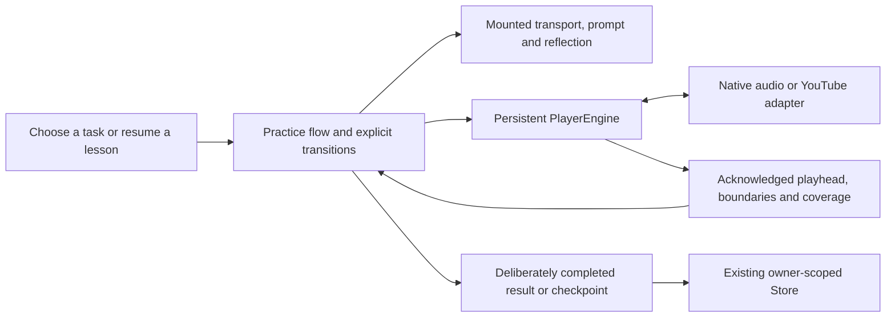
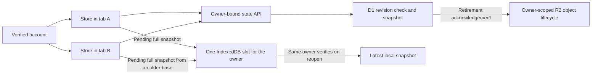

# Architecture and data assessment

**Baseline.** One delegated specialist assessed software architecture and data engineering independently of the lead, using `work` at `2b9b8fe`. This baseline includes audit remediation and two speaking prompts. The recommendations are for approval.

Keep browser ESM, the persistent media host and the Sites Worker with D1 and private R2. The architectural opportunity is to let people move from listening to speaking without coordinating several overlays or disturbing a lesson. The immediate data priority is to make an already saved device checkpoint recoverable when two tabs are open.

## Software Architect assessment

### What the current split achieves

The browser owns low-latency practice. `PlayerEngine` interprets native and YouTube media events, handles seeks and mode boundaries, and retains the media host across views. Import and transcript modules are separately testable. The Worker serves packaged assets and enforces cloud ownership and persistence. Practice timing can continue even when the state API is unavailable. The prior audit fixed concrete problems in owner transitions, media retirement, transport, local save cadence and offline boot. Its incremental target was appropriate for that work. The wider question of how product architecture could make it easier to start speaking remained open. [Player and adapter](../../src/player.mjs#L67) · [Packaged Worker](../../scripts/build.mjs) · [Prior architecture](../audits/2026-11-25-923d203/architecture.md) · [Remediation evidence](../audits/2026-11-25-923d203/roadmap.md)

### What limits the next practice journey

The latest speaking prompts show the cost of adding even stateless steps to the current shell. A prompt spans nested history, playback intent, inert regions, practice draft fields, focus restoration and account transitions. Rendering can pause the player and copy draft fields from the DOM, while route restoration separately decides whether to resume the queue. The tests establish the resulting behavior. More stages would inherit these dependencies. Sync and cue changes can also regenerate the shell, so focus and draft restoration are part of ordinary rendering. [Route capture](../../src/app.mjs#L53) · [Render and prompt coordination](../../src/app.mjs#L357) · [Prompt browser regression](../../tests/browser_speaking_prompts.py)

The engine holds a mutable lesson object from `Store.data` and updates listening coverage. The application saves progress and marks through other callbacks. A replaced lesson object can reload the player. This works for one player editing a broad snapshot. A future exercise must distinguish the media clock, playback intent, exercise stage, listening coverage and a deliberately completed response. Speaking unaided can be meaningful without creating a listened-duration increment or assigning a Practised mark. [Clock and coverage](../../src/player.mjs#L320) · [Store listener and player reload](../../src/app.mjs#L577) · [Current practice decisions](../PLAYER_DECISIONS.md)

### Alternatives

| Approach | User gain and trade-off | Decision |
| --- | --- | --- |
| Continue extending the current app with standalone prompts | Preserves familiar entry points and cheaply tests occasional cues. Each exercise adds its own transport, route, focus and draft cases if it remains an overlay. | Use for low-cost discovery, including the comparison with a paper cue and existing Resume. |
| One mounted practice surface with explicit exercise transitions | The person can prepare, hear a model if needed, speak and reflect without losing the lesson cursor or restarting the transport. | **Preferred extension.** Test one journey with existing ESM, clock adapters and Store. |
| Replace the view runtime or rewrite the browser client | Components and declarative transitions can help at larger scale. Identity, playback acknowledgements, sync decisions and data migration still need explicit domain design. | Revisit a bounded view-layer replacement if stable interfaces leave a measured cost. A whole rewrite has a high parity burden. |
| Simpler greenfield personal speaking app | A prepared activity, personal library, persistent player and brief reflection could form a coherent product with few screens. | Use as a comparison. Permissioned starter material and text keep the MVP small. Retaining existing imports, cue edits and Undo, private sync and media ownership brings back much of the domain complexity. |
| New hosting or native application | Could improve dependable private offline media or background playback if users need those capabilities. | Gate on observed needs and actual Sites and device constraints. Portable browser practice has already demonstrated useful behavior locally. |

### Target boundary

Start with one skill and one journey. Sketch the experience without reference media, then use a selected phrase as an optional reference. Keep the mounted media host, playback intent and draft stable while the exercise changes stage. Bind permission, focus and navigation effects to explicit transitions and redraw the affected region. Leave the current prompt and Resume available for comparison and reversal. If a cue or paper card produces the same outcome, its simplicity is a positive result. Private trials comparing E1 and E2 with paper, a favourite lesson and replay alone are documented but unrun. [Speaking prompt handoff](../product/speaking-prompt-handoff.md#outcomes-and-evidence)

Use this slice to eliminate duplicated transition rules before generalising it. Remove older paths only after proving they contribute no unique journey. The legacy Library renderer is selected by `ui.collectionId`, whose current assignments initialise or clear it. Verify entry points and Back behavior before removing that branch. [Library view switch](../../src/app.mjs#L150) · [Route restoration](../../src/app.mjs#L65)

## Data Engineer assessment

### Ownership and useful guarantees

| Data | Authority and strategic implication |
| --- | --- |
| Account library | One D1 row per owner and a revision compare-and-swap. Lessons, preferences and session history share each commit. A revision change in one domain affects the others. |
| Lesson, transcript and learning history | An internal UUID identifies a lesson. Cue IDs key marks and cue-specific settings. Source, parsed segments, edited phrases, Undo and recovery copies serve different needs. Keep IDs and timing valid across replacement and migration. |
| Device recovery | IndexedDB holds a snapshot and pending state at `state:<owner>`. Each Store serializes writes within its instance. A freshly loaded tab requires verified identity to read the private copy. |
| Account media | Private R2 stores the bytes. A D1 revision records retirement of confirmed unreferenced objects before physical deletion. The Worker rejects reintroduction. A cover or another lesson can keep an object live. |
| Voice and draft responses | Saved Mirror attempts remain in separate device-local storage. Speaking prompts use transient UI state. A portable library JSON contains account metadata and omits audio/artwork bytes, recordings and operational retirement intents. |

The distinction between browser persistence and cloud acknowledgement is valuable. So are owner checks, capacity responses, revision conflicts and a public-only offline shell. Keep these on each candidate path. A verified GET can recognise an acknowledgement lost after commit only when the entire returned copy matches at the next revision. [Owner and recovery code](../../src/store.mjs#L159) · [Conflict and portable export](../../src/store.mjs#L495) · [Media retirement and CAS](../../server/worker.mjs#L124) · [Device-local attempts](../../src/mirror.mjs#L12)

### Where the scope of a write causes problems

**Two tabs can lose an acknowledged local checkpoint.** Chromium 156 exercised the current application with two tabs in one browser context, real IndexedDB, a generated WAV and a disposable backend. Both tabs loaded revision 1. With PUTs interrupted, tab A played and paused at 3.930865 seconds. IndexedDB held that pending checkpoint. Tab B changed only the theme using its older view. The same slot then held light theme and position zero. Both tabs closed. A verified reopen recovered light theme at position zero. The cloud remained at revision 1. Independent Store instances with a simulated shared cache reproduced the sequence. The single slot and per-instance write lease explain the result. The sequence proves loss of the earlier completed device checkpoint. Field frequency is unknown. [Cache key](../../src/store.mjs#L61) · [Per-instance write lease](../../src/store.mjs#L277)

**Separate devices can conflict over unrelated edits.** With the current disposable Worker, device A had a checkpoint at 8 seconds. B added a collection and committed revision 2. A received a conflict with its 8 seconds still pending. The accepted copy kept the collection and the old position. CAS prevented the stale overwrite. Its whole-library scope requires a choice even for unrelated actions. Choosing the cloud copy gives up the pending cursor, while replacing it with the device copy gives up the collection. [State route](../../server/worker.mjs#L124) · [Store conflict choice](../../src/store.mjs#L495)

**Coalescing leaves the cost of each save.** The accepted 36-lesson, 16,950-cue test reduced 12.6 seconds of steady playback from 3 PUTs and 21,383,416 bytes to zero PUTs. It retained local progress around 10.15 seconds and promptly flushed Pause. A deliberate save still serialises the whole library, including transcript copies and history. The 16 MB transport cap and 1.95 MB encoded-row guard protect service limits. D1 documents a 2,000,000-byte string, BLOB or row maximum. A small result write could take separately evolving practice data out of a large save. The catalogue can still reach the same row ceiling. Its size merits a separate decision based on representative imports. [Scale evidence](../audits/2026-11-25-923d203/roadmap.md#6-measure-and-bound-long-session-work) · [Echo limits](../../src/sync-limits.mjs) · [D1 limits, official source](https://github.com/cloudflare/cloudflare-docs/blob/production/src/content/docs/d1/platform/limits.mdx)

**Offline access and recovery are separate jobs.** A fresh offline tab can open the cached shell and bundled prompt. Private data stays locked until owner verification. A previously verified tab can continue during an outage. Default browser storage is best effort. Persistent storage, when granted, can reduce eviction. A useful replacement-device export would need to carry user-selected objects, type and hashes, ensure intended rights and reattach media to the verified owner. Retention and optional export of voice attempts are separate choices. Test whether people need this journey before adding it to the library. [Offline behavior](../../README.md#run-and-verify) · [Backup and restore](../../src/store.mjs#L516) · [Browser storage guidance, official source](https://github.com/mdn/content/blob/main/files/en-us/web/api/storage_api/storage_quotas_and_eviction_criteria/index.md)

### Storage alternatives

| Model | What improves | Cost and decision |
| --- | --- | --- |
| Current cloud snapshot and local checkpoint with explicit write ownership | A canonical account library, verified cross-device recovery and an available checkpoint. | **Default.** Repair same-profile contention. Keep whole-copy choice for divergent catalogue edits. |
| Cloud-only persistence | Removes local synchronization and quota logic. | Outage or reload can discard pending edits and stop a normal session. That is a poor trade for the current product. |
| Device-only with explicit library export | True private first-run offline on the chosen device, without account service coupling. | Cross-device Resume and recovery become user-managed. Browser eviction and shared access remain relevant. A bundled public prompt already tests the strongest no-account benefit without changing ownership. |
| Add one independent practice outcome alongside the catalogue | Completed sessions can arrive independently, and retries with the same ID have one effect. A distinct cursor policy can reduce routine progress conflicts. | **Conditional prototype.** Begin with one stable outcome identity and a content-revision reference. A deliberate rewind is valid, so the greatest timestamp in the recording cannot decide Resume. |
| Entity-level operations or local-first CRDT | Multiple devices can edit offline and converge more often. | Higher cost for merge semantics, deletion, compaction and old clients. Cue timing conflicts and retired-media policy still need domain decisions. Revisit if offline editing from several devices becomes central. |

Anki documents a useful precedent. Ordinary changes can merge, some collection changes need a one-way choice and media sync stays separate. Automerge provides CRDT persistence and a synchronization protocol. These mechanisms illustrate what alternative designs could buy. Echo still needs its own cue, media and retention semantics. [Anki sync manual, official source](https://github.com/ankitects/anki-manual/blob/main/src/syncing.md) · [Automerge project](https://github.com/automerge/automerge)

### Reversible progression

1. **Protect device recovery first.** Compare the writer's observed local version inside an owner-bound IndexedDB transaction before replacing a shared recovery record. Preserve separate pending candidates when needed and clear only the acknowledged candidate. Verified same-owner startup can then recover both drafts or expose an explicit choice. A lifetime one-writer policy with visible transfer is simpler if users accept a secondary tab with restricted edits. Serializing individual writes cannot prevent a later stale write. Retain a readable path for older owner-scoped records and leave unknown legacy ownership unresolved.
2. **Keep the existing account path for the first guided-practice comparison.** Keep prompts and drafts transient until users demonstrate a need to resume them. Separate a deliberate result from listening coverage and phrase marks. If selective sync later qualifies, prefer an additive table or row family with a stable result ID, verified owner, validated content reference and idempotent acknowledgment. Specify deletion, backup and old-client visibility before activation.
3. **Carry forward restore and media guarantees.** Preserve IDs, transcript timing, Undo, account separation and the ordered `0000_user_state` then `0001_snapshot_payload` migration for legacy data. Test both current and older readers in a disposable SQLite copy and maintain rollback during any additive rollout. D1 batch execution supplies SQL transactions. R2 documents strong object consistency. Two separate bindings still require the explicit upload, accept and retire lifecycle. [Legacy migration test](../../tests/snapshot-sqlite.test.mjs) · [D1 transaction documentation, official source](https://github.com/cloudflare/cloudflare-docs/blob/production/src/content/docs/d1/worker-api/d1-database.mdx) · [R2 consistency documentation, official source](https://github.com/cloudflare/cloudflare-docs/blob/production/src/content/docs/r2/reference/consistency.mdx)

## Priorities and acceptance for approval

| Priority and accountable roles | User result and acceptance | Dependency, effort and reversal |
| --- | --- | --- |
| **1 · Reliable device recovery** · Data, Security, QA | With two same-owner tabs, a real IndexedDB checkpoint survives an unrelated later edit and reopening after interrupted cloud writes. Both changes remain recoverable, or the app clearly prevents a second writer before accepting its changes. Account switch and cold offline keep private data locked. Healthy single-tab checkpoints remain approximately five seconds apart. | Medium, driven by old-client compatibility and recovery UX. Test both designs with the observed sequence. Preserve the current readable snapshot and current API while validating. |
| **2 · A coherent first and returning practice session** · Product Design, Playback, Architecture, QA | Compare open-to-first-speech, completion of an unfamiliar response and voluntary reuse with a paper cue and ordinary Resume. A proposed discovery target is at least 30% faster median start with comparable unaided completion. Verify back, reload, interruption and denied permission. The mounted transport, paused cursor, draft and focus survive the expected transitions. | Medium for one journey. Proceed after the short comparative trial demonstrates a benefit. Keep the current entry points as controls and a rollout fallback. |
| **3 · Selective sync when demonstrated** · Data, Performance, QA | Practice completion and an unrelated collection edit from two devices both survive, retries count once and deletion has a tested outcome. Compare time to verified save at p50 and p95 under representative connections. Target at least 90% fewer wire bytes for outcome-only saves on the scale fixture. | Medium to high. Gate on repeated cross-device friction, visible save cost or storage pressure. Use an additive rollout and readable/exportable results. |

## Verification and limits

- The current targeted run of Store, owner, SQLite, media retirement, capacity, native clock and navigation passed **53 of 53**. The two-writer probes used current code and disposable fixtures. The browser checkpoint reproduction used Chromium 156 at 390 × 844 and reported no page errors. Coverage of that sequence establishes possibility and root cause.
- Direct documentation sites were blocked in this workspace. Official Cloudflare, MDN, Anki and Automerge source files were accessible through GitHub and verified for cited claims. Verification used public material and synthetic records and audio.
- Actual Sites identity and migrations, physical devices, permitted live YouTube and participant learning are open checks. Local engineering evidence establishes transport, data and control behavior. The comparative practice trials determine convenience and transfer outcomes. [Release validation limits](../audits/2026-11-25-923d203/roadmap.md#7-offline-startup-and-release-checks) · [Private comparison protocol](../product/speaking-prompt-handoff.md#outcomes-and-evidence)
