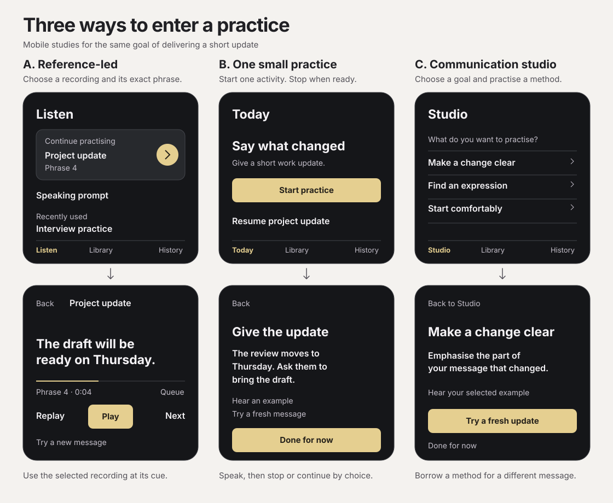

# Echo Studio design concepts

The best immediate opportunity is to make it obvious that the owner can speak before preparing a lesson, while keeping a prepared reference quick to resume. Test a **Practice** screen with these two entries and a short, optional bridge from an imitation to a different message. The current application can support the first comparisons with its existing speaking cues. The proposed navigation and more contextual exercise are candidates for approval. [Speaking practice handoff](../product/speaking-prompt-handoff.md)

## What the current experience suggests

I inspected fresh renders on `work` at `2b9b8fe` in Chromium 156. At 320 × 568 in Dark, empty Home gave import the strongest hierarchy, with the one-activation speaking prompt immediately below. At 390 × 844 in Light, Resume led populated Home, and one prepared lesson appeared in multiple shelves. The player kept the phrase dominant. Its Practice tab housed the transfer cue among selection, editing, completion and recording. The test used a disposable local library and native WAV, with external media blocked. These are expert walkthroughs of rendered screens, with no participant timings. [Current experience and captured evidence](current-experience.md)

| Current journey | Observed interaction path | Design implication |
| --- | --- | --- |
| Speak with nothing prepared | Home → **Try a speaking prompt**, one activation | Preserve its short path. Raise its hierarchy when the library is empty. Test whether users recognise what to do without reading the import card. |
| Resume prepared material | Home → **Resume lesson** → **Play**, two activations | Retain the low-cost route and explicit playback. Preserve the chosen source and cursor on handoff to any activity. |
| Try a new message | Home → **Resume lesson** → gear → **Practice** → **Try a new conversation**, four activations plus any optional listening | Compare one clearly named action within the paused or completed phrase experience. Keep a route when playback fails. |
| Revisit a known difficult phrase | Paused player → **Queue** → cue → **Play**, three activations on the sampled route | Test a short list of known difficult material in Library or History. A new practice task should never silently select new material. |
| Prepare an unready reference | On the sampled manual route, Add → source → URL → timed text → Preview → Save took six interactions to a prepared player, before Play and any external preparation. Import can also use a prepared archive. | A text cue solves the immediate need to speak. Technical work can independently reduce preparation for the owner who actually wants a reference. |

An activation counts a purposeful tap or keyboard activation from the stated starting screen. It excludes app start, loading, reading, speech, preparation outside the app and optional actions unless named. The table establishes path length for specific fixtures. It cannot establish which path a learner will notice, choose or finish.

## A. Reference-led listening

**Experience model.** The owner chooses the clip and controls how to practise. The strongest version of Echo's existing mental model is a personal reference player with quick return to an exact phrase. This fits a learner who already knows the speaker, recording or section they want.

| Surface | Proposal |
| --- | --- |
| Navigation and Home | **Listen · Library · History**. Listen leads with the last reference and up to one small recently used group. **Speaking prompt** is an immediate quiet alternative. Empty Listen gives that alternative prominence while keeping Import visible. |
| Library | Search, courses, collections and filters share a Library destination. Course ordering and independent collection membership keep their separate meanings. Show the most recent item and its resume state before collection or category management. |
| Practice and player | Use the existing phrase-first layout, persistent source and explicit Play. Show **Try a new message** in a completed or deliberately paused phrase context. Keep IPA a word-level action and Mirror an explicit optional comparison. Queue and technical controls stay secondary. |
| History | Show recent sessions and a route back to marked passages. Label listened coverage, practice marks and last position according to what each records. |
| Phone and desktop | Phone keeps player controls in reach and uses a queue sheet. A desktop list can remain beside the player. The mini-player expands to the same asset, clock and collection context. |
| Value and cost | Strongest library autonomy and lowest change cost. With a sparse library, it still asks the owner to supply and judge reference material. A replay-heavy design gives limited reason to retrieve language for a fresh message. |
| Technical implication | Simplify destinations and player entry while reusing the present transport and authorisation. Compare shallow navigation against keeping direct Search and Collections for frequent users. The current video player has a visible 200 × 200 full-size slot and a much smaller existing compact viewport. Verify full-size continuity or deliberate handover as distinct alternatives if video minimisation is reconsidered. Keep native audio continuity and test the external provider's embed constraints. |

**Journey.** Listen → Resume lesson → Play → pause or complete a phrase → optionally try a different message → return paused. Missing media leaves the caption and text alternative available. On a later visit the owner can resume the same lesson or choose a recorded difficult marking.

## B. One small practice

**Experience model.** Give the owner an optional short activity when they arrive without a particular recording in mind. It can begin from one realistic message, with an example only when there is a deliberate reason to hear it. A clear stopping point makes a small opening usable during an ordinary day.

| Surface | Proposal |
| --- | --- |
| Navigation and Home | **Today · Library · History**. Today offers one open prompt with one primary start and a separate Resume path. An open cue stays usable offline. **Today** describes an available activity. It carries no obligation to return on a schedule. |
| Library | Find, organise or import a personal reference. An activity can suggest choosing one existing model. Hold that reference within the same session so a back-and-forth browse loop is unnecessary. |
| Practice and player | **Hear an example** is optional. **Say what changed**, then **Try a fresh message** when useful. The open prompt offers **Done for now** at each stage. The existing player opens for deliberate detailed practice, with playback state retained when the learner returns. |
| History | Offer a dated activity history only if the owner wants it. An optional fresh cue can invite retrieval before replay after a delay. Report participation as participation. |
| Phone and desktop | A readable text surface with one reachable action and clear Back. On a desktop the same sequence can sit beside a reference pane. At the fresh message stage hide the model in either layout. |
| Value and cost | Removes the need to choose and prepare material before speaking. It can become repetitive with one cue or expensive to author at breadth. A poorly designed sequence makes a fast first utterance take longer for a prepared learner. |
| Technical implication | One bundled exercise plus optional session state is a cheap trial. Daily scheduling, repeat history, content curation, and new reference recordings require separate cost, retention and rights decisions. Compare a prompt card and the existing Home cue before committing to them. |

**Journey.** Today → Start practice → one original response → Done for now. An owner who wants imitation can hear an example and then say a different message, with an unrestricted exit. A later unseen task can first be supplied off-app.

## C. Communication studio

**Experience model.** Begin with a real communication goal and make practice selection easier over time. A goals page earns its place only if it makes repeated choices easier than a short prompt or a favourite lesson.

| Surface | Proposal |
| --- | --- |
| Navigation and Home | **Studio · Library · History**. Studio offers a small set of actionable goals such as **Make a change clear**, **Find an expression** and **Start comfortably**. Resume can skip selecting a goal again. Avoid abstract topic or proficiency menus on arrival. |
| Library | Retain user-owned organisation and search. Let a learner optionally associate a chosen reference with a goal. Avoid a second content hierarchy: a reference is still one lesson. |
| Practice and player | A goal opens one suitable activity with a concise method. **Make a change clear** can use a selected phrase as a model for stress, then invite a new update. **Find an expression** starts from communicative intention, before revealing the reference. **Start comfortably** can stay a paper cue or a quiet text route. The player is a reusable source within any activity. |
| History | Group concrete activity or optional retrieval records around the chosen goal. Omit inferred improvement levels and scores. Keep access to existing lesson history. |
| Phone and desktop | Offer one list and at most one decision per state on mobile. Desktop can place the goal list beside the selected method. An unfinished activity can exit to its actual origin. |
| Value and cost | Makes it easier to connect language work with a meeting or conversation. A rarely used taxonomy creates a lengthy setup and can falsely imply systematic diagnosis. Highest curation and information architecture cost. |
| Technical implication | Start with a few original goal labels and text-only methods. Broad taxonomy, skill history, auto-tagging and scoring would add data contracts, maintenance and unsupported interpretation. Compare the three goals with simply offering an original speaking cue first. |

**Journey.** Studio → Make a change clear → Try a fresh update → speak. Hearing a model is optional. Return from an interruption to the user's choice, with the previous media cue paused and without requiring a goal label on an ordinary listening session.

## Proposed direction for approval

Combine the rapid start of B with the precise reference experience of A. Introduce C's goal language within a specific activity when it makes the task clearer. Use a provisional **Practice · Library · History** structure in discovery artefacts.

- **Practice** gives a prepared owner **Resume lesson** and gives anyone **Say a short update**. On empty and verified-offline Home, the open cue can lead. Use the existing resume route in early trials. If empty users already find and use the cue at the same rate, keep the present hierarchy.
- **Library** owns preparation and organisation. Compare visible entry points to search, Import and Collections against the current five-item phone navigation. Moving a high-use route costs an extra tap if it also hides a recognisable action. Keep prominent Search access where repeated search demands it.
- **Player** owns the exact reference. Compare a named **Try a new message** action available after hearing or choosing a phrase with the current path in Practice options. Keep the option quiet during playback. Upper-level navigation and a text activity never start the media on their own.
- **History** lets the owner return to practiced material and see what they actually did. Test promoting it from Settings before placing it in persistent navigation. Start the delayed, unseen retrieval comparison off-app. Promote a short activity record only where its value outweighs retention and sync work.

| Decision to test | Starting expectation based on the wireframes | What would change the decision |
| --- | --- | --- |
| First visit with an empty library | A preserves a one-action cue. B offers one main action to a prompt. C asks for a goal and then a method or activity. The combined model retains one-action entry. | If the combined model does not help people notice and voluntarily use the cue, keep the current Home structure. If a goal reliably helps someone choose what to say, consider the smallest goal list that produced that result. |
| Returning with a prepared lesson | A gives the clearest priority to Resume. B and C require particular care to keep a visible return. The combined model should take two activations through explicit Play. | Prefer A or a lighter existing Home change if polished prompts compete with Resume or require a prepared user to dismiss a proposed activity. |
| Try the technique again in another message | A and the combined model use a named transition out of a chosen phrase. B supplies a sequence from the first cue. C supplies a purposeful method chosen before each session. | If a later unseen task shows comparable unaided performance after simpler equal-time replay, keep an optional prompt without guided sequences or persistent skill records. |

### Future surface contracts

| Concern | Target |
| --- | --- |
| First speech | One labelled action to an original cue from empty and populated Practice. No lesson, recording or choice of method is required. Use fictional text and keep the offline shell's private library gate. |
| Prepared session | Preserve a route of at most two activations from arrival to explicit Play. Exit an activity to the same reference, playback mode, phrase, cursor, queue and draft options. Use a fresh explicit Echo Play after cancelling a pending start. A no-media route stays useful. |
| One-handed use | Put Play, Replay and Exit in an unobstructed thumb zone. Keep 44 CSS px hit areas, distinct controls and safe-area insets. Retain the current visible navigation and queue alternatives to gesture actions. Verify browser Back, reading, selection and swipe do not consume one another. At medium widths, use a queue sheet or reserve enough player width for the open queue to leave every transport reachable. |
| Narrow and enlarged text | Reflow at 320 × 568, at browser 200% zoom and in short landscape. Keep whole headings readable, long text selectable and scrolling bounded inside the phrase or cue. Focus must remain visible and return to the launch control. |
| Visual direction | Retain Echo's charcoal and soft neutral browsing surfaces, with the established restrained player accent. One phrase or prompt owns the typographic emphasis. Use thin dividers for Library, stable action rows and only one clear primary action per activity. Compare light and dark contrast and use a neutral fallback when artwork fails. |
| Recovery | Choose a readable status and a specific recovery action for missing captions, media failures, account locks and conflicts. Keep activity exits available. Optional recordings continue to be explicit and private. |

### Design transformation epics

| Priority and initiative | Before → proposed experience | Alternatives and cost | Evidence and acceptance to earn the change |
| --- | --- | --- | --- |
| 1 · Immediate practice entry | Import-led empty Home and a secondary prompt → a direct speaking choice alongside the existing prepared Resume | Existing layout, paper cue, full Today sequence. Low presentation complexity with moderated checks across the two states. Depends on the existing locked/offline contract. | Test first-use cue discovery, time to first purposeful speech and prepared resume against current Home. Preserve one activation to model-free speech, two to prepared Play, intentional pause and private-library isolation. Stop if the change improves neither discovery nor voluntary use. |
| 2 · Reference-to-message bridge | Transfer behind gear and Practice → an optional, clearly named next action associated with one selected feature | Keep current placement, use an off-app prompt, or guide a whole session. Medium workflow complexity. Depends on evidence of usefulness, timing/transfer preservation and reviewed prompt copy. | Proposed entry takes one action from the paused or completed phrase to the cue, with UI comparisons on phone. Accept only after exact return-state checks and a comparable unaided communication task. Waive no playback, focus or draft protections to meet a tap target. |
| 3 · Library and recovery structure | Multiple Home shelves and separate browse destinations → one browse and preparation area with visible Search and predictable return | Current destinations with reduced duplicative shelves, or combine Collections/Search in Library. Medium navigation cost if persistent tabs move. Depends on use observations and a rehearsal with existing collections and imports. | Reduce category/repeated content distractions without increasing frequent search-to-Play path length or losing collection context. Validate import draft recovery and error exits in the existing data model before adding formats. |
| 4 · Return and recall | Session history in Settings and exact lesson resume → find a prior practice or optionally try a fresh cue before replay | Keep History in Settings, elevate it in Practice, or give it primary navigation. Low to medium for entry changes, higher if new history is stored. Depends on evidence that owners revisit tracked work. | Locate and resume a marked phrase without misread status. Separate return to app, practice completion and unfamiliar message performance. A short paper comparison can decline the need for new stored activity records. |

For the concept study, counterbalance present and candidate flows with matched fictional tasks. Record the time to first independently formulated speech, taps, decisions, incomplete tries, error recovery, and next-day voluntary reuse as separate measures. For learning, use an unseen message before replay and compare it with equal-time replay. Ask an unaware willing listener what meaning came across where available. Keep recording optional and leave unobserved outcomes blank. Diagnose whether choice, media preparation or relevance of the cue explains the difference before revising navigation. [Current private pilot procedures](../product/speaking-prompt-handoff.md)

## Comparable experience patterns

Primary project documentation was inspected on 25 November 2026. The network proxy denied direct access to the Spotify, Headspace, Apple Fitness+, Duolingo, Notion and British Council pages attempted. The accessible project sources below substantiate specific design patterns. They provide no comparative usability measurements, and the maintained applications of those projects were not run for this review.

| Source and observation | Transferable principle and limit |
| --- | --- |
| **AntennaPod** documents a dedicated Android podcast manager. [Official repository](https://github.com/AntennaPod/AntennaPod) | A saved reference library can support strong owner choice. A personal practice queue still needs to keep a phrase distinct from its whole source. |
| **Medito** specifically serves first-time and experienced meditators and describes entry without sign-up. [Official repository](https://github.com/meditohq/medito-app) | Make the public, bundled activity available before preparation. Echo's personal media and history still require verified ownership. |
| **Anki** separates question and reveal during review and keeps study anchored to a selected deck. [Studying manual](https://github.com/ankitects/anki-manual/blob/main/src/studying.md) | Present a new cue before the model in delayed retrieval. Flashcard correctness rules do not assess an intelligible spontaneous update. |
| **wger** offers editable routines and tracks progress. [Official repository](https://github.com/wger-project/wger) | Separate a chosen recurring routine from observations produced during it. Echo has no basis for carrying over automatic progression or body metrics. |
| **Super Productivity** distinguishes choosing a task, focusing on it and reviewing it. Its README describes local ownership with optional sync. [Official repository](https://github.com/super-productivity/super-productivity) | Design a clear end to a practice and keep review secondary. Retain Echo's existing private data boundary when proposing a cue. |
| **SpeechAce** documents a service that takes audio and a reference string and returns scores at several language levels. [Official API examples](https://github.com/speechace/speechace-api-samples) | Any feedback should match a clearly defined task. Comparing recorded speech with a reference changes privacy and introduces scoring assumptions. Start Echo's fresh-message test with a willing listener's observed understanding or the owner's optional reflection. |

The Independent Design Critic should check the three concepts against first use, prepared listening, phone interruption, keyboard paths, failure, scope and editorial load. The comparison should identify when either pure model would be more useful than the proposed combination.
