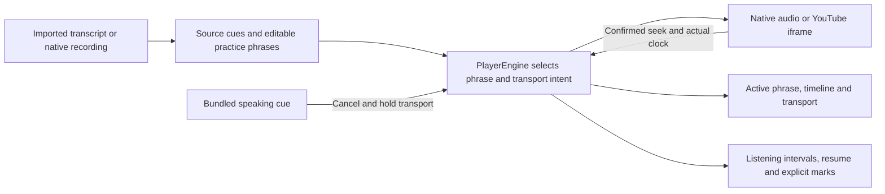

# Playback and performance assessment

Playback and Performance Engineer assessment of `work` at `2b9b8fe01fd9f49a31326aa0727f77b894519044`, 25 November 2026. Evidence includes current source inspection, a fresh Chromium scale run, a five-run small-library probe and upstream technical documentation. The broader [strategy](strategy.md) owns the proposed product direction and approval sequence.

## Decision

Make a short, useful speaking activity the entry point for deliberate practice. It can start with original text or one permissioned, ear-checked native recording whose clip is the exercise boundary. Retain full-recording listening, Replay, Manual and Automatic shadowing, the existing library, user-edited cues and source adapters. Offer a fresh message after hearing a model when that helps the chosen skill. A learner should be able to skip the model, speak without a microphone and leave with their place intact. Test whether a reference improves a new utterance and whether the owner wants to reuse it before building a catalogue. [Speaking-prompt handoff](../product/speaking-prompt-handoff.md) · [Player decisions](../PLAYER_DECISIONS.md)

The earlier audit answered whether the existing player was reliable. It identified important timing faults, compared media clocks and supported focused repairs such as preserving cue identity, fixing seeks and bounding long queues. Its hypotheses assumed that acquiring a recording plus timed transcript was the normal cost of getting to speech. The strategic alternative removes that dependency for prompt-only practice and complete reference clips. It keeps the advanced player available when natural context, long-form listening, a familiar voice or repeated exact cues are the actual goal. Retaining the present workflow alone leaves new sessions dependent on finding suitable material, preparing captions and resolving source differences. [Prior playback assessment](../audits/2026-11-25-923d203/specialists/playback-engineer.md) · [Verified remediation](../audits/2026-11-25-923d203/roadmap.md)

## What the current player already protects

- Continuous follows the actual recording and original cues. It selects the first active phrase in an overlap, leaves the previous one visible during a gap and continues across boundaries. Manual and Automatic use the intended cue and its optional lead-in. Automatic schedules the speaking wait and advances without a mark. Replay, Previous, direct selection and listening leave practice marks alone. Next records a deliberate Practised action. Playability comes from the source clock after seek confirmation. The transcript guides interpretation and the accepted clock drives timing. [Player and coverage](../../src/player.mjs) · [Timing decisions](../PLAYBACK_SYNC.md)
- The native adapter maps media time through the saved audio offset and reports metadata, seeks, waiting and time events. The iframe controller receives asynchronous states from YouTube. A source generation discards callbacks from retired players, a pending seek protects its intended phrase, and the prompt guard cancels in-flight starts and scheduled speaking waits. The prompt guard can require a deliberate Echo Play or Replay after interruption because a late provider notification carries no gesture identity. Cue timing on either source remains subject to browser scheduling, decoder behavior and media readiness. [Audio adapter](../../src/audio.mjs) · [Player controller](../../src/player.mjs) · [Speaking cue validation](../product/speaking-prompt-handoff.md#local-verification-on-25-november-2026)
- Direct YouTube creation requires a video ID and timed caption preview. Matching private native audio can be attached after creation. ZIP already accepts a native audio lesson with missing captions, retaining the source and disabling phrase-dependent actions. A single short native clip with optional transcript currently lacks an equivalent direct entry. Keep manual and ZIP import routes and authored edits during any new preparation pilot. [Manual import and source settings](../../src/app.mjs) · [ZIP lesson construction](../../src/library-ui.mjs) · [ZIP contract](../ZIP_IMPORT.md)
- Mirror separately plays the native original, verifies the requested segment and starts capture only after hearing the complete interval. It also has device-only attempts and optional waveforms. Options carries a separate untimed recorder. This creates two capture affordances and several media clocks for a capability that is optional for listening and speaking. Compare simple listen-back with and without waveforms before consolidating capture entry. If comparison proves valuable, one opt-in flow can reuse its cancellation, retention, playback and permission protections. Preserve saved attempts and access during such a change. [Echo Mirror](../../src/mirror.mjs) · [Untimed recorder](../../src/recorder.mjs) · [Mirror interaction](../ECHO_MIRROR.md)

## Source and playback alternatives

| Alternative | What a learner gains | Cost and decision |
| --- | --- | --- |
| Original text or an off-app cue | A usable first reply with an empty library, a stalled source or silent planning. The same intent can be practised later without the wording. | Low setup and maintenance. Use the existing Home and transfer cues for comparison. Keep a paper version in the pilot. An audio model is useful when the goal is hearing an unfamiliar rhythm, articulation or delivery. [E1 and E2](../product/speaking-prompt-handoff.md) |
| Complete, permissioned native utterance | Playback starts on a tap, the learner hears the full thought, and ordinary EOF provides the final edge. A second voiced context or an original reply can follow without scheduling another recording. | Moderate editorial effort. Start with one recording in the device player using the E3 method. Hear the file on the intended phone speaker and headphones before distributing it. Try a tiny set only after the first clip repeatedly helps compared with a comparable favourite. Account-independent delivery applies only to material expressly cleared for it. [E3 pilot and rights checklist](../product/speaking-prompt-handoff.md#e3-f1-and-e3-f2--try-one-permissioned-reference-off-app) |
| Long private native source with supplied captions | Keeps a meaningful lecture, interview or personal recording in context. The same material supports listening, exact chosen replay, corrections and optional Mirror. | Retain streaming `HTMLMediaElement`, signed offset mapping and existing owner-scoped audio delivery. A simplified selection of one useful span or direct native input could save packaging work. Compare it against ZIP and whole-clip preparation at an equivalent listening goal. [Audio adapter](../../src/audio.mjs) · [Private media endpoint](../../server/audio.mjs) |
| Official YouTube embed and lawful user-supplied captions | Wide choice and continuity for existing favourites. Users keep video context, embeddable source controls and transcript practice where a matching track is available. | Retain one official visible embed. Expect variable startup, keyframe seeks, rates and embeddability. Treat unavailable sources or captions as a reason to choose a different source or continue with the original cue. Compare a full-size visible video state or explicit pause and open on return against the current compact variant. [IFrame API reference](https://developers.google.com/youtube/iframe_api_reference) · [YouTube policies](https://developers.google.com/youtube/terms/developer-policies) |
| Web Audio scheduling for every repeat | `AudioBufferSourceNode.start()` can schedule a bounded offset and duration against the audio context clock for an already decoded short clip. | Decoding duplicates work and a buffer source is single-use. Streaming a long track with an HTML media element avoids holding its decoded waveform in memory. Reserve Web Audio for a measured short-clip boundary or alignment need. Prototype it only if whole-clip EOF or native media fails the intended exercise. [MDN node scheduling](https://github.com/mdn/content/blob/main/files/en-us/web/api/audiobuffersourcenode/start/index.md) |

The current full-player video slot has a 200 × 200 CSS-pixel minimum. The compact slot displays a 40-pixel thumbnail region, scales the 200 × 200 iframe by `0.2`, and disables pointer interaction. Verify its effective visibility, controls and playback after leaving the page against current provider guidance before adopting it in a new design. The project requires visible YouTube playback through an official embed. The policy pages linked here returned HTTP 403 from this runner, so this remains a release compatibility question. [Full and compact styles](../../src/mobile-player.css) · [Compact markup and dock placement](../../src/app.mjs) · [Project rules](../../spec.md#24-non-negotiable-youtube-rules) · [Required minimum functionality](https://developers.google.com/youtube/terms/required-minimum-functionality)

Private audio already has its own authenticated ranged media route. A released built-in clip would need an explicitly supported media asset path, appropriate MIME handling, a byte budget and a replacement or withdrawal mechanism. The current generated service worker caches public shell files and omits private data and media. Any offline clip policy needs a licence covering those copies and a way to expire them prospectively. The text cue can be the fallback. [Private audio route](../../server/audio.mjs) · [Shell packaging](../../scripts/shell-assets.mjs) · [Offline contract](../audits/2026-11-25-923d203/roadmap.md#7-offline-startup-and-release-checks)

Caption acquisition from YouTube depends on authorisation and track availability. Google’s discovery description exposes separate caption list and download calls and requires OAuth scopes `youtube.force-ssl` or `youtubepartner`. Before any creator integration, confirm edit and download permission for that specific track. The alternatives are a caption file the owner can lawfully supply, a direct native clip or an untimed prompt. A podcast, audiobook or published educational resource can be useful on its official page, with each recording, performance and transcript cleared for any proposed reuse. [Google discovery document, read](https://github.com/googleapis/discovery-artifact-manager/blob/master/discoveries/youtube.v3.json) · [Caption permissions reference](https://developers.google.com/youtube/v3/docs/captions/download)

## Timing, preparation and provenance

Subtitles encode display intervals. A valid pair of timestamps can span multiple speakers, omit a spoken reduction, leave clipped speech or include silence. The current parser preserves supplied ends, normalises recognised roll-up captions, estimates ends for start-only text and can group existing segments by gap, punctuation, speaker and target duration. It discards unusable supplied word intervals. Optional regrouping and Undo protect deliberate edits and earlier progress. A suitable speaking unit also needs an audible complete thought and a useful practice target. [Transcript parser](../../src/transcript.mjs) · [Original-playback recovery](../../src/playback-recovery.mjs) · [W3C WebVTT specification source, read](https://github.com/w3c/webvtt/tree/gh-pages)

A fresh Node probe supplied the same two fictional sentences with starts at 1.0 s and 6.0 s. With explicit WebVTT ends, exact grouping produced `1.0–2.4` and `6.0–7.6` seconds. With the starts alone, it produced `1.0–6.0` and `6.0–9.0`, tagged both as estimated and emitted the final-boundary warning. The first estimate includes 3.6 seconds beyond the supplied comparison end. The probe describes parser behavior on these inputs. [Supported formats and bounds](../../src/transcript.mjs)

| Preparation option | Reliability and effort | Decision |
| --- | --- | --- |
| Author one complete line, trim the delivered take and verify both edges | An editor hears the actual words, speaker, rhythm and relevant contrast. A short context lead-in can remain when it helps comprehension. Cost is consent, editing and editorial time. | First comparison for targeted native models. Store the spoken words and editorial intent separately. Whole clips can play without per-word alignment. |
| Repair a bounded excerpt of a timed source | Keep correct imported intervals. During deliberate repair use the actual audio, select or merge clear speaking turns, show the original boundaries, and allow Undo. Preserve unknown word times and ambiguous speaker changes. | Test a single excerpt workflow against preparing the whole recording. Grouping is useful for access. Automatically grouped captions still need review where cut quality matters. |
| Offline forced alignment of a known transcript | Montreal Forced Aligner uses an acoustic model and pronunciation resources. It can draft timings for permitted recordings. Mismatched words, overlapping speakers and insufficient pronunciation coverage can raise correction time. | Trial on a workstation only after manual time is measured. Score end-to-end preparation minutes, missed words and both-edge corrections against an ear-checked sample. [Montreal Forced Aligner workflow, read](https://github.com/MontrealCorpusTools/Montreal-Forced-Aligner/blob/main/docs/source/user_guide/workflows/alignment.rst) |
| Offline ASR then alignment | WhisperX describes language-specific models and missing timestamps for unalignable words. Drafts can help when a long licensed source has no text, with model setup, compute and editorial work. | Compare with a manual or existing-transcript workflow on authorised files. Keep optional and outside runtime until it measurably saves time. A paid speech service would add consent, processing, cost and failure dependencies. [WhisperX upstream limitations, read](https://github.com/m-bain/whisperX#limitations-) |

For a future pilot with reusable material, add a small versioned source description alongside existing data before considering a migration. Record the source type and identity, the exact recording version, transcript origin, whether each boundary is supplied, estimated or heard and verified, and the compatible timing offset. Keep a reference to the editorial approval and any permission expiry or withdrawal instructions. The rights record should cover script, performance, recording, transcription, editing, distribution, audience and attribution. Keep private grants separate from app content and leave unknown historical provenance unknown. Original cues, edited phrases and practice records keep their own identities. An edited recording requires a new check of its timing and permissions. [Current media and transcript metadata](../../src/library-ui.mjs) · [Rights checklist](../product/speaking-prompt-handoff.md#e3-f1-and-e3-f2--try-one-permissioned-reference-off-app)

## Architecture choices

Keep one media authority per playback surface. A small practice flow can sequence a chosen intention, an optional reference, a reply and an optional later probe. It can use the native player or the existing prepared lesson as a reference. A text-only activity needs only the available shell. Reuse the media adapters, lesson state and recovery guarantees. A reply completion, user reflection or listener observation has its own meaning. Listening intervals, playback time and Practised marks retain their current meanings. [Session accounting](../../src/player.mjs) · [Cue exercises](../product/speaking-prompt-handoff.md)

Keeping the whole-player controller as the only practice model would make a timed lesson and source selection prerequisites for new exercises. Building fresh adapters or a second general media controller would duplicate hard-won seek, permission, route and lifecycle behavior. Scope a native complete-reference flow first. Exercise the existing controller against the same lesson before exploring adapters, and leave architectural replacement contingent on equivalent measured behavior. A focused native path can remove the mandatory YouTube ID and mandatory caption upload for one complete-clip exercise. An optional short clip or a paper prompt can also remove preparation altogether for many practices. [Audio adapter](../../src/audio.mjs) · [Media and route coverage](../../tests/browser_speaking_prompts.py)

## Measured system and interaction performance

The earlier `923d203` audit reported a large-library median of 1,061 ms from cold navigation to sync over three local runs and 827 ms in one reused context. It observed three progress PUTs and 21,383,416 bytes during 12.6 seconds, 101 paused native clock callbacks in two seconds, and a 1,200-row queue when resuming late. The paired remediation recorded a 228.5 to 28.2 ms decline in median late-queue synchronous time, no steady PUTs and no idle native reads. These are dated measurements on documented local synthetic fixtures. The cold-sync measure has yet to be repeated here. [Audit performance report](../audits/2026-11-25-923d203/specialists/performance-engineer.md) · [Remediation benchmark](../audits/2026-11-25-923d203/roadmap.md#6-measure-and-bound-long-session-work)

Fresh command `python3 tests/browser_playback_scale.py` on `2b9b8fe` used Chromium 156.0.8078.79, Node 24.22.3, a 390 × 844 mobile viewport, loopback, generated 8 kHz MP3, 36 lessons and 16,950 cues. The fixture sent a 7,124,955-byte state envelope with a 2,404-second lesson and ran each queue point seven times. External media was blocked and service workers were disabled by the harness. [Maintained benchmark](../../tests/browser_playback_scale.py) · [Browser fixture](../../tests/browser_fixture.py)

| Fresh measure | Observed today |
| --- | --- |
| Queue at cue 1 of 1,200 | 80 rows in all seven runs. 31.8 ms median synchronous opening and 57.1 ms median through two animation frames. |
| Queue at cue 1,171 of 1,200 | 80 rows in all seven runs. 30.4 ms median synchronous opening and 54.8 ms median through two animation frames. |
| Native idle | 0 media clock reads in a two-second window after settling. |
| Steady listening | 0 state PUTs and 0 request bytes in 12.619 seconds. Native playback advanced 12.570 seconds and the device checkpoint reached 10.179 seconds. |
| Deliberate Pause and reload | Paused at 12.835 seconds, saved 12.827 seconds and reopened paused. |

A second five-sample loopback probe used the same Chromium and phone viewport, a fresh context per sample, one private generated 10-second 16 kHz WAV, a cue at `1.000–3.250`, and `startupLesson: none`. At verified Home the text prompt appeared in 10.2 ms median synchronous action time and 25.6 ms through two animation frames. Resume took 50.3 ms median to an enabled Play. The interval from installing the `playing` listener immediately before Playwright clicked Play to receiving that event was 65.7 ms median. That interval includes driver time. One foreground Manual run paused at 3.2532 seconds. The generated-tone probes measure interface and decoder readiness. First speech, perceived sound quality and general timing bounds require other evidence. The scale run is the maintained repeatable workload. [Fixture and audio instrumentation](../../tests/browser_fixture.py) · [Native event timing reference, read](https://github.com/mdn/content/blob/main/files/en-us/web/api/htmlmediaelement/timeupdate_event/index.md)

## Performance decisions and acceptance

- **Protect readiness.** Log the visible cue, a ready media control, first actual clock advancement, stall and usable fallback separately in disposable tests. The user comparison measures time to first speech and unaided delivery. Start with the current prompt, a prepared favourite and one permissioned clip in comparable conditions. Test open or Resume at 320 × 568 and 390 × 844 first, then a representative phone on warm, cold, throttled and unavailable media paths. A proposed usability target is one deliberate action from ready Practice to a usable first cue, and a 75th-percentile warm first-cue response under one second on the stated phone. Test the condition before adopting the budget. An account-unavailable shell can still offer its public bundled cue. [Speaking prompt contract](../product/speaking-prompt-handoff.md) · [Offline behavior](../audits/2026-11-25-923d203/roadmap.md#7-offline-startup-and-release-checks)
- **Measure the cost of preparing a source early.** Home can initialise a preferred lesson or warm the YouTube API after owner verification. That can shorten a later Resume and can also compete with the activity the learner wants right now. In a disposable comparison, defer provider contact until a playback action in the new Practice path and record request counts, first-cue readiness and Resume readiness. Preserve the user’s existing startup choice until there is evidence for a different default. [Home startup and source warm-up](../../src/app.mjs)
- **Keep active playback precision and bound render work.** Preserve the paired 36-lesson and late queue regression. Retain at most 120 mounted queue rows and a 100 ms median synchronous open budget in the matched local workload. Add long-transcript cue transitions and Options interactions under slower CPU to see whether persistent transcript updates become the remaining perceptible cost. `LyricsScroller.mount` still creates an all-phrase key and walks all lyric rows when its parent renders. An update keyed to content revision and changed active rows is a smaller experiment than virtualising accessible transcript browsing. Preserve keyboard order, free scroll, Current phrase follow, text selection and rapid seek before replacing an entire reading surface. Keep the high-frequency active boundary sampling until actual cue-edge evidence supports a change. Native idle and open speaking sheets already stop periodic clock work. [Lyrics surface](../../src/lyrics.mjs) · [Clock schedule](../../src/player.mjs) · [Queue and rendering](../../src/app.mjs)
- **Measure the saved-work path beyond the first checkpoint window.** A 15-second deadline coalesces remote saves, but each accepted remote write still serialises the full snapshot and device checkpoints still store a library record. A longer run should log device write time, request size, radio/network scenario, recovery after no acknowledgement and stale-revision conflicts. Use the existing 12.6-second acceptance of at most one scheduled remote write and intact local checkpoints as a regression. Assess a smaller position/coverage write with revision checks only if longer matched workloads show important cost. The snapshot model and its conflict protections are a justified default until that evidence. [Store checkpoint and flush](../../src/store.mjs) · [State size rules](../../src/sync-limits.mjs)
- **Remove expensive optional work before replacing the platform.** Compare plain play-and-compare against waveform display with actual consenting test material. The waveform path can fetch and decode the full original within its duration and byte limits and keep a decoded buffer. If listening comparison produces the same learner decision, simple controls avoid a duplicate decode. Explore off-app editing and alignment before any always-running service. Mobile energy, memory peaks, live YouTube accuracy and hosted latency require measured device or release checks to quantify. [Mirror waveform path](../../src/mirror.mjs) · [Deployment validation limits](../audits/2026-11-25-923d203/roadmap.md#7-offline-startup-and-release-checks)

Proposed pilot gate for native reference practice: each approved example has verifiable provenance, a complete audible start and end on phone and desktop, deliberate playback and skip, useful unavailable-source recovery, and an unchanged saved lesson when leaving the activity. Exercise rapid Repeat, speed, seek, interruptions, old adapter callbacks, and the return from a cancelled Automatic wait. Compare new-message delivery at equal elapsed practice time with replay alone and with the paper cue. Use an unaided later message and optional listener understanding separately from faster access or more replay. If a prepared favourite or paper cue meets the same job with lower cost, keep the simpler route. The current evidence establishes interface and local playback behavior. Owner outcomes, physical mobile performance, hosted behavior, rights clearance and permitted live playback remain open evidence. [Practice and evidence plan](../product/speaking-prompt-handoff.md) · [Controller regressions](../../tests/player.test.mjs) · [Seek alignment regressions](../../tests/seek-alignment.test.mjs)
